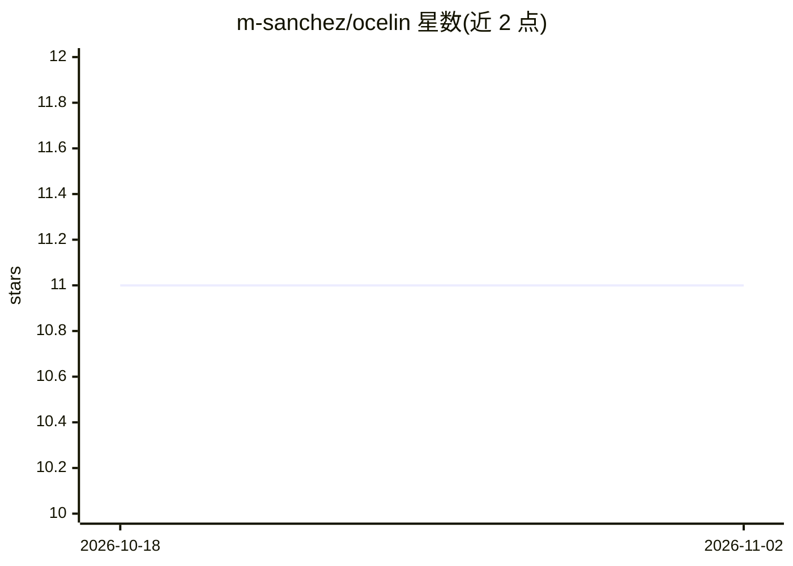

# m-sanchez/ocelin

⭐ 11 · JavaScript · MIT · 推送 2026-10-05 · [GitHub](https://github.com/m-sanchez/ocelin) · [官网](https://miguelsanchez.co.uk/ocelin/) · 个人维护

**本地仪表盘与 Windows 伴生工具：监控管理 Claude Code / Codex 会话**

面向在自己电脑上运行 Claude Code 或 Codex 的开发者的本地监控与项目仪表盘工具：浏览器核心为纯 Node 标准库实现、零运行时依赖，绑定 127.0.0.1 本地回环服务；展示活跃会话分组、订阅额度与重置倒计时、可搜索的历史会话与对话预览、事件时间线与 trace 瀑布图、成本与上下文遥测、git worktree 与 CI/评审状态等。Windows 伴生应用提供任务栏条、悬浮条、托盘与 Doctor 清理功能，安装器为未签名预览版。可选 Ask Ocelin 通过本地 claude -p 进程发送问题与脱敏快照。不写入 forge，模型输出不能变更任何状态。

## 筛选速览

| 维度 | 判定 | 备注 |
|---|---|---|
| AI 角色 | `ai-ecosystem` | LLM/agent 周边工具 |
| 许可风险 | `permissive` | MIT |
| 部署形态 | `library` | 以包/库形式分发 |
| 模型依赖 | — | README 未给出锁定关系 |
| 硬件要求 | — | 无带数字的原话,不猜 |
| 安装摩擦 | `low` | 无编译、无系统依赖或容器化 |
| 成熟度 | `idea` | |

## 能力要点

- 浏览器核心零运行时依赖、绑定 127.0.0.1 回环并按启动令牌保护特权路由
- 会话监控、订阅额度百分比、历史搜索与对话预览、重开会话需人工确认
- trace 瀑布图与会话诊断（慢轮次、重复调用、疑似循环）及 burn rate 估算
- 评审收件箱、CI 读取、决策账本均只读，模型输出不能变更状态

## 适用场景

- 查看哪些 Claude Code 或 Codex 会话正在运行或需要我处理
- 跟踪订阅额度剩余与成本消耗趋势
- 搜索并重新打开保存的历史会话
- 在项目工作台里看会话遥测、git 状态与 CI 结果

## 场景标签

`LLM 可观测性` · 领域:评测与运维

## 证据(README 行号)

> L3: Ocelin, formerly Clawdeck, is a local dashboard and optional Windows companion for developers who run Claude Code or
> L84: An **unofficial local dashboard for Claude Code and Codex**. Point it at any project you
> L142: **Ask Ocelin** (Prompt hub) is optional. It sends your question and a compact,

## 星数曲线

2026-10-18 11 → 2026-11-02 11（+0）

---
*卡片 v1 · prompt 1.4 · 生成 2026-11-02 · 置信度 high · 依据 README sha `9192e45944f1` · [字段定义](../../DATASET.md)*
