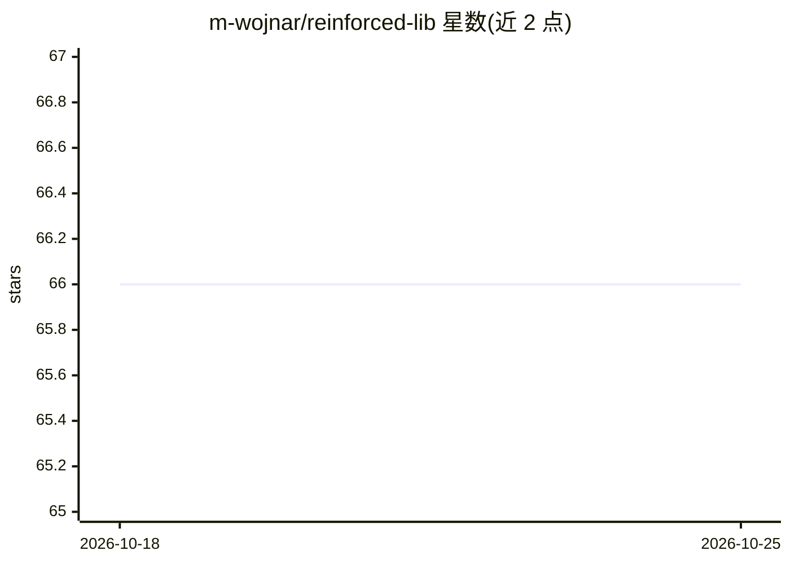

# m-wojnar/reinforced-lib

⭐ 66 · Python · CC-BY-4.0 · 推送 2026-08-31 · [GitHub](https://github.com/m-wojnar/reinforced-lib) · [官网](https://reinforced-lib.readthedocs.io) · 组织维护

**基于 JAX 的轻量级强化学习库，支持模型导出到嵌入式设备**

Python 强化学习库，提供深度 RL 与经典非神经智能体，基于 JAX 构建，利用 JIT 编译加速执行并保证结果可复现。核心组件包括 RLib 接口模块、Agents、Extensions、Loggers 四个模块，实现智能体与环境交互、领域知识增强观测、训练监控等功能。兼容 DeepMind 的 JAX 生态，支持将训练模型导出为 TensorFlow Lite 以部署到低功耗无线设备。通过 PyPI 安装，面向研究与原型开发场景，附有关联论文可供引用。

## 筛选速览

| 维度 | 判定 | 备注 |
|---|---|---|
| AI 角色 | `ai-native` | 本体是模型或模型工具 |
| 许可风险 | `viral` | CC-BY-4.0 |
| 部署形态 | `library` | 以包/库形式分发 |
| 模型依赖 | — | README 未给出锁定关系 |
| 硬件要求 | — | 无带数字的原话,不猜 |
| 安装摩擦 | `low` | 无编译、无系统依赖或容器化 |
| 成熟度 | — | 结构信号不足 |

## 能力要点

- 基于 JAX，提供 JIT 编译、自动微分与跨 CPU/GPU/TPU 可移植性
- 支持将训练模型导出为 TensorFlow Lite 部署到低功耗设备
- Agents/Extensions/Loggers 模块化设计与结果可复现的随机数机制
- 提供 DRL 与经典非神经智能体

## 适用场景

- 快速原型化强化学习解决方案
- 在低功耗嵌入式设备上部署训练好的 RL 智能体
- 科研中做可复现的 RL 实验并监控训练指标

## 场景标签

`强化学习` · 领域:训练与推理

## 证据(README 行号)

> L10: **Introducing Reinforced-lib:** a lightweight Python library for the rapid development of reinforcement-learning (R
> L12: reinforcement learning (DRL) and classic non-neural agents. Built on JAX,

## 星数曲线

2026-10-18 66 → 2026-10-25 66（+0）

---
*卡片 v1 · prompt 1.4 · 生成 2026-10-24 · 置信度 high · 依据 README sha `368bfad4145e` · [字段定义](../../DATASET.md)*
