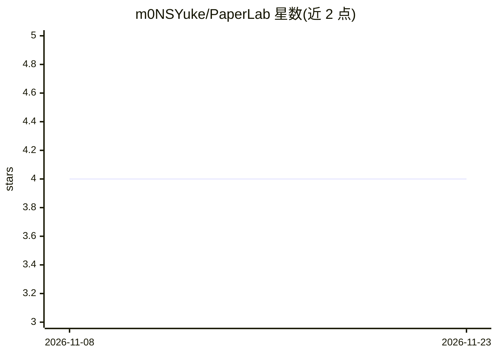

# m0NSYuke/PaperLab

⭐ 4 · TypeScript · MIT · 推送 2026-10-28 · [GitHub](https://github.com/m0NSYuke/PaperLab) · [官网](https://m0nsyuke.github.io/#projects/paperlab) · 个人维护 · 中文 README

**本地运行的 AI 论文阅读工作台：原文旁给出处可查的中文讲解**

本地优先的科研论文阅读工作台：左侧 PDF.js 渲染原文，右侧逐条带页码引句、发布前校验的中文讲解报告；内置四步读法（速览→精读→自测→笔记）、研究线与知识库检索（本地 BM25）。报告由 Claude Code /paper 技能或 Codex 工作台生成；划词翻译可选离线运行（ECDICT 词典 + llama.cpp 跑腾讯 Hy-MT2 模型）。数据全部为本机 JSON/Markdown 文件，网页不调用模型 API。安装脚本面向 Windows，其他平台需自行启动。

## 筛选速览

| 维度 | 判定 | 备注 |
|---|---|---|
| AI 角色 | `ai-native` | 本体是模型或模型工具 |
| 许可风险 | `permissive` | MIT |
| 部署形态 | `desktop` | 安装包/桌面程序 |
| 模型依赖 | local-ok | 支持本地模型 |
| 硬件要求 | — | 无带数字的原话,不猜 |
| 安装摩擦 | `medium` | 含编译或系统依赖之一 |
| 成熟度 | — | 结构信号不足 |

## 能力要点

- 有出处报告：结论带页码引句，发布前逐条校验并区分论文事实/推断/待核实
- 全程离线划词翻译：77 万词条 ECDICT + llama.cpp 本机运行 Hy-MT2 模型
- 研究线整理、BM25 本地知识库检索与知识图谱，不调用任何模型或 embedding 接口
- 数据为本机普通文件，自动 zip 备份并保留最近 10 份

## 适用场景

- 按四步读法精读 arXiv 或本地 PDF 论文并检验理解
- 在文献库按研究方向组织论文并本地检索笔记
- 选中英文离线翻译，术语译法保持统一

## 场景标签

`知识库管理` `知识图谱` `科研工具` · 领域:知识与检索

## 证据(README 行号)

> L5: **读懂论文，而不只是读完。** 一个在自己电脑上运行的 AI 科研论文阅读工作台：左边看原文 PDF，右边看有出处可查的中文讲解，选中英文即可离线翻译，读完用自测题和研究判断检验自己是否真的懂了。
> L89: 2. 在本项目目录打开 Claude Code 运行 `/paper <arXiv ID 或 local-ID>`，或在 Codex 中运行 `$paper …`；也可以用阅读器里的「Codex 工作台」（使用你本机 Codex 
> L127: - 服务只绑定 127.0.0.1（局域网模式需口令）。网页本身不调用任何模型 API，也不需要 API Key；Codex 工作台调用的是你本机已登录的 Codex CLI，划词翻译完全离线。

## 星数曲线

2026-11-08 4 → 2026-11-23 4（+0）

---
*卡片 v1 · prompt 1.4 · 生成 2026-11-21 · 置信度 high · 依据 README sha `0ce3232caba0` · [字段定义](../../DATASET.md)*
