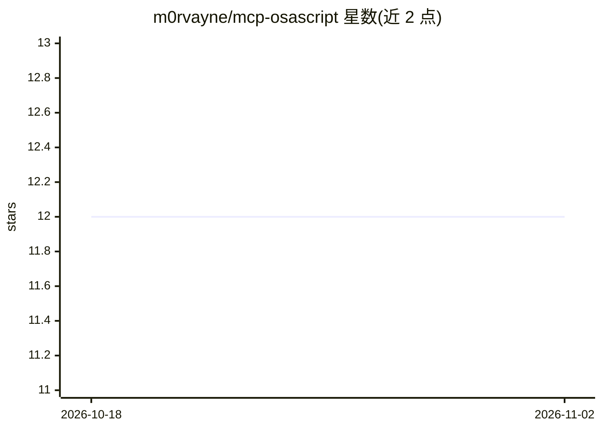

# m0rvayne/mcp-osascript

⭐ 12 · JavaScript · MIT · 推送 2026-09-11 · [GitHub](https://github.com/m0rvayne/mcp-osascript) · 个人维护

**让 Claude 控制 macOS 的 MCP 服务器：18 个类型化工具**

面向 Claude Desktop、Claude Code、Cursor、VS Code 等 MCP 客户端的 macOS 自动化服务器：通过 AppleScript/JXA 提供 18 个带输入校验的类型化工具，覆盖窗口管理、菜单点击、键盘输入、剪贴板读写、浏览器标签读取、截图与 Shortcuts 执行。权限分无权限/Automation/Accessibility/Screen Recording 四档，菜单点击失败时返回可用项列表供重试。含 84 个集成测试与四次作者自聘的红队审计；run_osascript 工具可执行任意脚本，信任边界为 MCP 客户端。要求 macOS 13+ 与 Node 18+。

## 筛选速览

| 维度 | 判定 | 备注 |
|---|---|---|
| AI 角色 | `ai-ecosystem` | LLM/agent 周边工具 |
| 许可风险 | `permissive` | MIT |
| 部署形态 | `library` | 以包/库形式分发 |
| 模型依赖 | — | README 未给出锁定关系 |
| 硬件要求 | — | 无带数字的原话,不猜 |
| 安装摩擦 | `low` | 无编译、无系统依赖或容器化 |
| 成熟度 | — | 结构信号不足 |

## 能力要点

- 18 个类型化工具：窗口/菜单/键盘/剪贴板/浏览器标签/截图/Shortcuts
- 权限分四档，check_permissions 报告已授权项与解锁工具
- 安全机制：URL scheme 白名单、环境变量最小化、错误脱敏、不可信输出包裹
- 菜单点击未命中时自动返回该层级可用项供模型重试

## 适用场景

- 通过对话让 Claude 操作 Mac 应用、点击菜单与移动窗口
- 让 Claude 读取剪贴板和浏览器标签并执行自动化流程
- 以 MCP 工具形式为本地 agent 提供 macOS 系统控制能力

## 场景标签

`GUI 自动化` · 领域:效率与自动化

## 证据(README 行号)

> L3: **Let Claude control your Mac.** Move windows, click menus, type text, read clipboard, manage browser tabs, take scr
> L11: m0rvayne/mcp-osascript MCP server
> L32:  Config for other clients (Cursor, VS Code, Claude Code)

## 星数曲线

2026-10-18 12 → 2026-11-02 12（+0）

---
*卡片 v1 · prompt 1.4 · 生成 2026-11-01 · 置信度 high · 依据 README sha `74f70411dd3a` · [字段定义](../../DATASET.md)*
