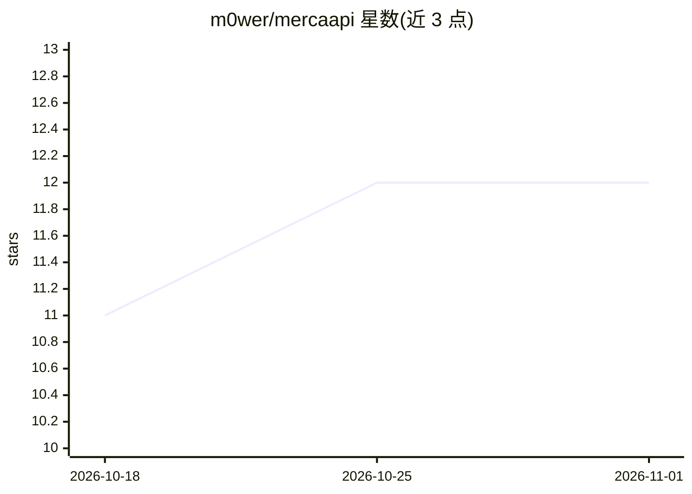

# m0wer/mercaapi

⭐ 12 · Python · 推送 2026-07-28 · [GitHub](https://github.com/m0wer/mercaapi) · [官网](https://mercaapi.sgn.space/api/docs) · 个人维护

**面向开发者/研究者的 Mercadona 非官方商品数据 API，附营养信息**

非官方 REST API，提供 Mercadona 超市商品、分类与价格数据，并通过 OpenAI 兼容模型（对商品图片做视觉抽取、按商品详情估算兜底）补充营养信息。支持按邮编探测仓库、逐仓库追踪库存与价格历史及价格差异。以 Docker Compose 部署为主，CLI 脚本定期解析上游 API 更新数据库。项目声明与 Mercadona 无官方关联，使用需自担风险。

## 筛选速览

| 维度 | 判定 | 备注 |
|---|---|---|
| AI 角色 | `ai-enhanced` | 去掉 AI 部分产品仍成立 |
| 许可风险 | `none` | — |
| 部署形态 | `self-host` | docker 或自建部署 |
| 模型依赖 | — | README 未给出锁定关系 |
| 硬件要求 | — | 无带数字的原话,不猜 |
| 安装摩擦 | `low` | 无编译、无系统依赖或容器化 |
| 成熟度 | — | 结构信号不足 |

## 能力要点

- 商品/分类/价格 REST 端点（含单商品详情）
- 用 OpenAI 兼容模型从商品图片抽取营养信息，商品详情估算兜底
- 按仓库追踪库存、价格历史与相对主目录的价格差异
- Docker Compose 部署，cron 定期更新数据库

## 适用场景

- 获取 Mercadona 商品与营养数据做应用开发
- 追踪不同门店仓库的库存与价格变化历史
- 研究人员分析西班牙超市商品价格数据

## 场景标签

 · 领域:零售/超市数据 API

## 证据(README 行号)

> L7: `mercaapi` is an unofficial API that provides access to Mercadona product data,
> L52: information using an OpenAI-compatible model (vision extraction from product

## 星数曲线

2026-10-18 11 → 2026-11-01 12（+1）

---
*卡片 v1 · prompt 1.4 · 生成 2026-11-01 · 置信度 mid · 依据 README sha `0927333f2dea` · [字段定义](../../DATASET.md)*
