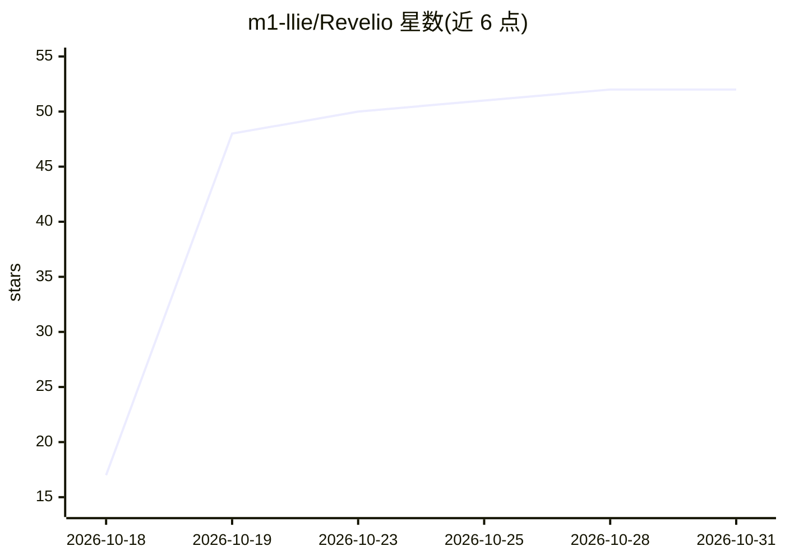

# m1-llie/Revelio

⭐ 52 · Python · 推送 2026-10-26 · [GitHub](https://github.com/m1-llie/Revelio) · [官网](https://arxiv.org/pdf/2606.22263) · 组织维护

**检测大规模 C/C++ 代码库内存安全漏洞的 AI Agent**

端到端 AI agent，面向大型 C/C++ 代码库的内存安全漏洞检测：两阶段流水线——Stage 1 用廉价模型做多轮 LLM 假设生成（tree-sitter 静态预处理、去重、可达性标注、Docker 子代理静态过滤、排序）；Stage 2 由更强模型构建 Proof-of-Vulnerability 输入，在 AddressSanitizer/UBSan/MSan 下复现确认，仅报告经 sanitizer 确认的漏洞并输出完整报告。被测代码运行在 Docker 容器内隔离，模型经 litellm 接入 Anthropic/Gemini 等提供商，支持多档模型配置与 API key 池。提供脚本将 OSS-Fuzz 项目构建为可用镜像。

## 筛选速览

| 维度 | 判定 | 备注 |
|---|---|---|
| AI 角色 | `ai-native` | 本体是模型或模型工具 |
| 许可风险 | `none` | — |
| 部署形态 | `self-host` | docker 或自建部署 |
| 模型依赖 | locked-api |  |
| 硬件要求 | — | 无带数字的原话,不猜 |
| 安装摩擦 | `low` | 无编译、无系统依赖或容器化 |
| 成熟度 | — | 结构信号不足 |

## 能力要点

- 两阶段架构：廉价模型高召回假设生成 + 强模型 PoV 构建确认
- 仅报告 sanitizer（asan/ubsan/msan）可复现确认的漏洞，附 PoV 与复现步骤
- tree-sitter 静态预处理、去重合并、可达性标注与 Docker 子代理过滤的假设流水线
- 模型分级配置（hypothesis/pov 两档）与 litellm 多提供商接入

## 适用场景

- 对仓库级 C/C++ 项目做内存安全漏洞挖掘
- 将 OSS-Fuzz 项目打包后进行零日漏洞检测
- 复用已生成的假设队列分阶段运行检测

## 场景标签

`网络安全` · 领域:学习与行业

## 证据(README 行号)

> L7: Revelio is an end-to-end AI agent that discovers memory-safety vulnerabilities in large C/C++ codebases, and only re
> L50: 2. **Sanitizer-backed confirmation** — the `validate` tool runs the harness against **all available sanitizers** (a

## 星数曲线

2026-10-18 17 → 2026-10-31 52（+35）

---
*卡片 v1 · prompt 1.4 · 生成 2026-10-24 · 置信度 mid · 依据 README sha `620c77949a17` · [字段定义](../../DATASET.md)*
