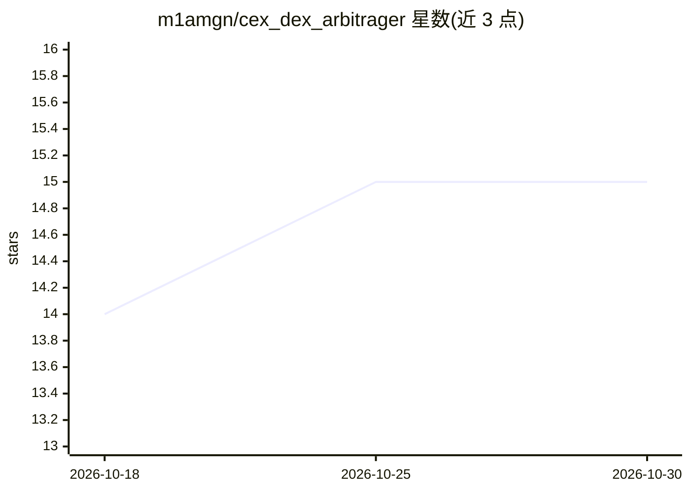

# m1amgn/cex_dex_arbitrager

⭐ 15 · Python · 推送 2026-09-10 · [GitHub](https://github.com/m1amgn/cex_dex_arbitrager) · 个人维护

**加密市场低效检测工具：跨所价差扫描与上新公告检测**

Python 编写的市场数据工具，含两个子系统：其一是套利扫描器，将 25 个 CEX 与 10 个 DEX（覆盖 11 条网络）的报价归一化为统一价格模型，按热度分层调度（30s/120s/600s）在限速内扫描，按网络设定价差与成交量阈值，仅报告扣除执行成本后仍成立的价差，并在扫描前通过白名单与 CoinGecko 校验代币；其二是上新检测，12 个交易所公告解析器之外，用 Gemini 2.0 Flash 从 Telegram 频道自由文本中提取 symbol、上市时间与计价资产，通道文本被视为不可信输入并有提示注入防护。仅检测与告警，不下单。

## 筛选速览

| 维度 | 判定 | 备注 |
|---|---|---|
| AI 角色 | `ai-enhanced` | 去掉 AI 部分产品仍成立 |
| 许可风险 | `none` | — |
| 部署形态 | `library` | 以包/库形式分发 |
| 模型依赖 | — | README 未给出锁定关系 |
| 硬件要求 | — | 无带数字的原话,不猜 |
| 安装摩擦 | `low` | 无编译、无系统依赖或容器化 |
| 成熟度 | — | 结构信号不足 |

## 能力要点

- 25 CEX + 10 DEX + 11 网络的报价归一与分层调度扫描
- 按网络区分的价差/成交量阈值过滤，仅报告覆盖成本的信号
- 12 个公告解析器 + Gemini LLM 提取双路径上新检测
- LLM 输入做不可信处理：关键词预过滤与提示注入防护

## 适用场景

- 监控同一资产在 CEX/DEX 间的实时价差机会
- 提前从交易所公告中获取代币上新事件
- 对新上检测管线做含成本模型的历史回测

## 场景标签

 · 领域:金融/加密货币交易工具

## 证据(README 行号)

> L78: LLM (Gemini 2.0 Flash) to extract `symbol`, `listing_datetime` and
> L107: **Detection and alerting only. This does not place orders.**

## 星数曲线

2026-10-18 14 → 2026-10-30 15（+1）

---
*卡片 v1 · prompt 1.4 · 生成 2026-10-30 · 置信度 mid · 依据 README sha `368bebe212f0` · [字段定义](../../DATASET.md)*
