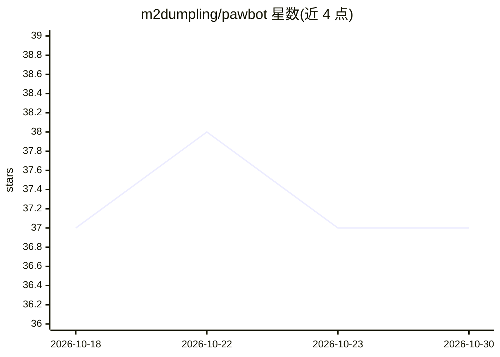

# m2dumpling/pawbot

⭐ 37 · Python · MIT · 推送 2026-10-28 · [GitHub](https://github.com/m2dumpling/pawbot) · 个人维护 · 中文 README

**自托管 AI agent：浏览器/终端/聊天应用执行任务并支持录制回放**

面向自托管用户的多端 AI agent 运行时：通过 WebUI、终端 TUI、CLI、API 与聊天渠道访问同一 agent，可读写文件、执行命令、搜索网页、调用 MCP 工具、维护会话记忆与定时任务。核心机制为 Record & Replay——录制一次真实 agent 回合后离线重放当前编排代码，不产生新的模型请求、token 费用或真实工具副作用，可用于调试、回归测试与重构。支持 Anthropic、OpenAI 兼容端点与本地模型，暴露 Python SDK 与 OpenAI 兼容 API。以 PyPI 包（pawbot-ai）发布，需 Python 3.11+。

## 筛选速览

| 维度 | 判定 | 备注 |
|---|---|---|
| AI 角色 | `ai-native` | 本体是模型或模型工具 |
| 许可风险 | `permissive` | MIT |
| 部署形态 | `library` | 以包/库形式分发 |
| 模型依赖 | locked-api |  |
| 硬件要求 | — | 无带数字的原话,不猜 |
| 安装摩擦 | `low` | 无编译、无系统依赖或容器化 |
| 成熟度 | — | 结构信号不足 |

## 能力要点

- Record & Replay：离线重放已录制的 agent 回合，无新模型请求与真实工具副作用
- WebUI / CLI-TUI / API / 聊天渠道共享同一会话、工具与配置
- MCP 服务器接入、扩展加载与 TaskContract 任务断言
- 提供 Python SDK 与 OpenAI 兼容 API

## 适用场景

- 在本机或私有服务器上运行统一入口的 AI agent 处理文件、命令与检索任务
- 用离线回放做 agent 编排的调试与回归测试
- 让 agent 在聊天应用中长期在线并执行定时任务

## 场景标签

`Agent 框架` `浏览器自动化` · 领域:Agent 开发

## 证据(README 行号)

> L7: ### A self-hosted AI agent for your browser, terminal, and chat apps.
> L17: The feature that makes pawbot different is **Record & Replay**:

## 星数曲线

2026-10-18 37 → 2026-10-30 37（+0）

---
*卡片 v1 · prompt 1.4 · 生成 2026-10-25 · 置信度 high · 依据 README sha `17eb2d6aa308` · [字段定义](../../DATASET.md)*
