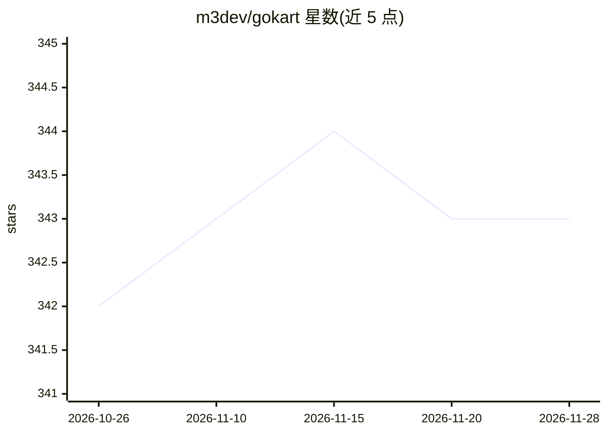

# m3dev/gokart

⭐ 343 · Python · MIT · 推送 2026-11-27 · [GitHub](https://github.com/m3dev/gokart) · [官网](https://gokart.readthedocs.io/en/latest/) · 组织维护

**面向 ML 工程的 pipeline 框架：解决可复现性与任务依赖**

基于 luigi 的 Python 机器学习 pipeline 框架。每个 Task 的输出数据、模块版本、随机种子、参数等元数据随 hash 存入 pkl 文件，参数变更时自动重跑；中间结果以文件形式在任务间交换，支持 S3/GCS 作为中间数据存储，提供 pandas DataFrame 列校验、numpy/random 种子自动固定，并通过 redis 对并行任务加锁。声明非实验管理工具（结果管理由 Thunderbolt 承担），不支持任务可视化，建议以 Python 而非 toml/yaml 描述 pipeline。

## 筛选速览

| 维度 | 判定 | 备注 |
|---|---|---|
| AI 角色 | `ai-ecosystem` | LLM/agent 周边工具 |
| 许可风险 | `permissive` | MIT |
| 部署形态 | `library` | 以包/库形式分发 |
| 模型依赖 | — | README 未给出锁定关系 |
| 硬件要求 | — | 无带数字的原话,不猜 |
| 安装摩擦 | `low` | 无编译、无系统依赖或容器化 |
| 成熟度 | — | 结构信号不足 |

## 能力要点

- Task 元数据（输出、模块版本、随机种子、参数）随 hash 存储，参数变更自动重跑
- 支持 S3/GCS 作为中间结果存储，任务间以文件交换数据
- pandas DataFrame I/O 列校验，numpy/random 种子自动固定
- redis 锁支持并行任务的锁定

## 适用场景

- 构建可复现的机器学习批处理流水线
- 团队协作开发中管理任务依赖与中间产物
- 将任务中间结果保存到 S3 或 GCS

## 场景标签

`MLOps` · 领域:训练与推理

## 证据(README 行号)

> L7: Gokart solves reproducibility, task dependencies, constraints of good code, and ease of use for Machine Learning Pip
> L107: gokart is a wrapper for luigi. Thanks to luigi and dependent projects!

## 星数曲线

2026-10-26 342 → 2026-11-28 343（+1）

---
*卡片 v1 · prompt 1.4 · 生成 2026-11-25 · 置信度 high · 依据 README sha `55198ee9bbf2` · [字段定义](../../DATASET.md)*
