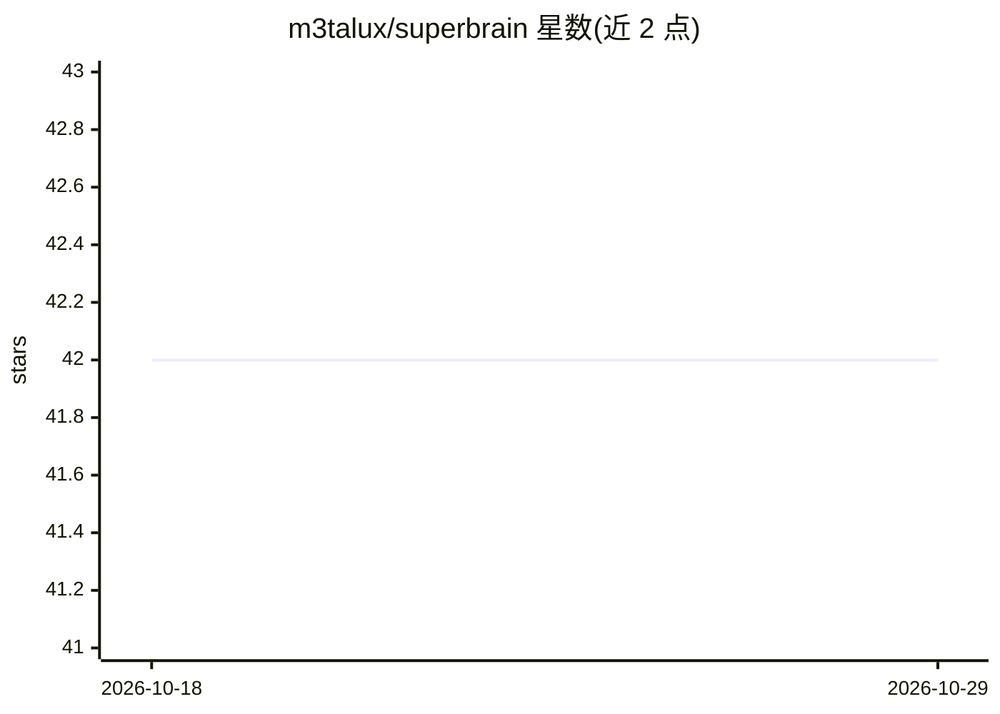

# m3talux/superbrain

⭐ 42 · TypeScript · MIT · 推送 2026-08-11 · [GitHub](https://github.com/m3talux/superbrain) · 个人维护

**Claude Code 插件：自动把每次会话沉淀为 Obsidian 笔记库**

面向 Claude Code 用户的会话记忆插件：通过 PostToolUse/UserPromptSubmit 钩子以 NDJSON 事件流观察会话，捕获路径不调用 LLM；在 PreCompact/SessionEnd 等检查点由独立的 claude -p 进程读取增量并分类写入自有 Obsidian markdown 库（~/.superbrain/vault），生成项目笔记、决策、人物、每日日志等结构。提供本地混合检索（FTS5 BM25 + sqlite-vec + MiniLM 嵌入）、stdio MCP 服务器与偏好注入。零配置、无独立 API key（可选切换到 Anthropic API）、数据不离开本机，不同步到云端。处于活跃开发期，接口可能在正式发布前变化；macOS/Linux 经 CI 测试，Windows 支持进行中。

## 筛选速览

| 维度 | 判定 | 备注 |
|---|---|---|
| AI 角色 | `ai-ecosystem` | LLM/agent 周边工具 |
| 许可风险 | `permissive` | MIT |
| 部署形态 | `None` |  |
| 模型依赖 | locked-api |  |
| 硬件要求 | — | 无带数字的原话,不猜 |
| 安装摩擦 | `medium` | 含编译或系统依赖之一 |
| 成熟度 | `idea` | |

## 能力要点

- 钩子捕获路径不调用 LLM，检查点由独立 claude -p 进程做摘要写入
- 纯 Obsidian markdown 库（wikilinks/frontmatter/git 可同步），append-or-create 不覆盖用户编辑
- 本地混合检索：FTS5 BM25 + sqlite-vec + 全本地 MiniLM 嵌入，带 BM25 回退
- 复用 Claude Code 认证，零配置，无必需环境变量

## 适用场景

- 让 Claude Code 的会话决策与试错历史跨项目、跨机器留存
- 在 Obsidian 中浏览和编辑由会话自动生成的项目知识与每日日志
- 通过 MCP 或技能让后续会话检索此前项目上下文

## 场景标签

`Agent 记忆` `知识库管理` · 领域:Agent 开发

## 证据(README 行号)

> L3: **Session memory for Claude Code — a second brain that builds itself.**
> L71: 3. **Distill at checkpoints** — at `PreCompact`, `SessionEnd`, or a pending-gated `Stop`, one detached, lock-serial
> L93: - ✅ `superbrain-recall` skill + stdio MCP server (`superbrain_search`) for model-invoked deep search

## 星数曲线

2026-10-18 42 → 2026-10-29 42（+0）

---
*卡片 v1 · prompt 1.4 · 生成 2026-10-25 · 置信度 high · 依据 README sha `22a5a0cc2daf` · [字段定义](../../DATASET.md)*
