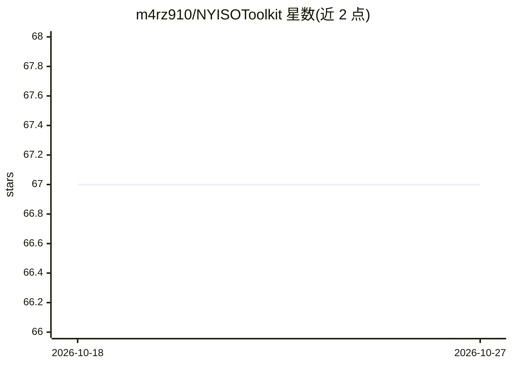

# m4rz910/NYISOToolkit

⭐ 67 · Jupyter Notebook · MIT · 推送 2026-07-23 · [GitHub](https://github.com/m4rz910/NYISOToolkit) · 个人维护

**纽约州电网数据访问、统计与可视化 Python 包**

面向纽约独立系统运营商（NYISO）公开数据的 Python 包，含三个模块：NYISOData 读取 11 类数据集（负荷、预测、燃料组合、断面潮流、LBMP 电价、辅助服务价格、容量价格等，小时或 5 分钟分辨率，统一为 UTC）；NYISOStat 生成统计；NYISOVis 生成可视化图，主题围绕 CLCPA 电力部门脱碳目标。数据源为 NYISO 官方 MIS 公开数据，通过 pip 从 GitHub 安装，另提供 Web App 浏览可视化。

## 筛选速览

| 维度 | 判定 | 备注 |
|---|---|---|
| AI 角色 | `ai-knowledge` | 知识聚合/清单类 |
| 许可风险 | `permissive` | MIT |
| 部署形态 | `library` | 以包/库形式分发 |
| 模型依赖 | — | README 未给出锁定关系 |
| 硬件要求 | — | 无带数字的原话,不猜 |
| 安装摩擦 | `low` | 无编译、无系统依赖或容器化 |
| 成熟度 | — | 结构信号不足 |

## 能力要点

- 11 类 NYISO 数据集访问（负荷/电价/潮流/容量等），UTC 统一时区
- 原始数据重采样到目标频率并在需要时插值
- NYISOStat 统计生成与 NYISOVis 可视化输出
- 可视化围绕 CLCPA 脱碳目标（2030 年 70% 可再生、2040 年零排放）

## 适用场景

- 分析纽约电网负荷、电价与燃料组合的时间序列
- 研究纽约电力部门脱碳进展并生成图表
- 参加 Kaggle 电力数据相关竞赛时获取整理好的数据

## 场景标签

 · 领域:能源/电力系统数据

## 证据(README 行号)

> L3: A package for accessing power system data (`NYISOData`), generating statistics (`NYISOStat`), and creating visualiza
> L27: Dataset Name | Resolution | Description

## 星数曲线

2026-10-18 67 → 2026-10-27 67（+0）

---
*卡片 v1 · prompt 1.4 · 生成 2026-10-24 · 置信度 low · 依据 README sha `47f61834559e` · [字段定义](../../DATASET.md)*
