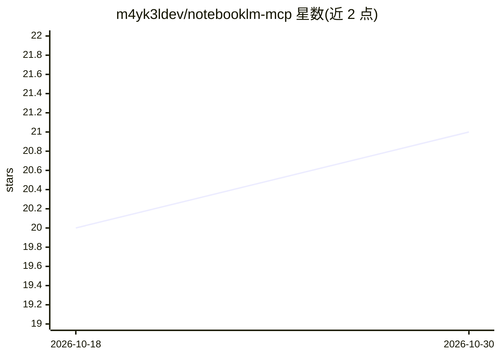

# m4yk3ldev/notebooklm-mcp

⭐ 21 · TypeScript · MIT · 推送 2026-10-20 · [GitHub](https://github.com/m4yk3ldev/notebooklm-mcp) · [官网](https://github.com/m4yk3ldev/notebooklm-mcp#readme) · 个人维护

**把 Google NotebookLM 接入 MCP 的本地服务器（27 个工具）**

基于 stdio 的 MCP 服务器，通过 CDP 自动登录 Google 账号提取会话 Cookie，向 Claude Desktop、Cursor、VS Code 等 AI 客户端暴露 27 个 NotebookLM 工具：管理笔记本、导入 URL/YouTube/Google Drive/文本来源、调用 Google Deep Research、生成 Audio Overview 播客、简报、信息图、幻灯片与测验。会话过期时后台自动重连；无头/CI 环境可用环境变量注入 Cookie。要求 Node.js ≥ 20 与 Chrome/Chromium（用于登录）。

## 筛选速览

| 维度 | 判定 | 备注 |
|---|---|---|
| AI 角色 | `ai-ecosystem` | LLM/agent 周边工具 |
| 许可风险 | `permissive` | MIT |
| 部署形态 | `library` | 以包/库形式分发 |
| 模型依赖 | locked-api |  |
| 硬件要求 | — | 无带数字的原话,不猜 |
| 安装摩擦 | `low` | 无编译、无系统依赖或容器化 |
| 成熟度 | — | 结构信号不足 |

## 能力要点

- 27 个工具覆盖笔记本、来源导入、深度研究与 Studio 内容生成
- CDP 自动化登录流程，会话过期后台透明重连
- 支持 URL、YouTube 转录、Google Drive 文件、原始文本等多种来源导入
- 提供 15+ 个 AI 客户端的配置文件路径与接入示例

## 适用场景

- 在 Claude/Cursor 等 AI 助手中直接管理 NotebookLM 笔记本
- 把 NotebookLM 的 Audio Overview、简报生成纳入编程工作流
- 通过 MCP 触发 Google Deep Research 并导入结构化结果

## 场景标签

`文档问答` · 领域:知识与检索

## 证据(README 行号)

> L13: > **New to MCP?** The Model Context Protocol is a standard for connecting LLMs to external data sources and tools. 
> L20: - 🕵️ **Autonomous Research**: Harness Google's Deep Research engine. Start a task, poll its progress, and import st

## 星数曲线

2026-10-18 20 → 2026-10-30 21（+1）

---
*卡片 v1 · prompt 1.4 · 生成 2026-10-28 · 置信度 high · 依据 README sha `2a3c010ad8a8` · [字段定义](../../DATASET.md)*
