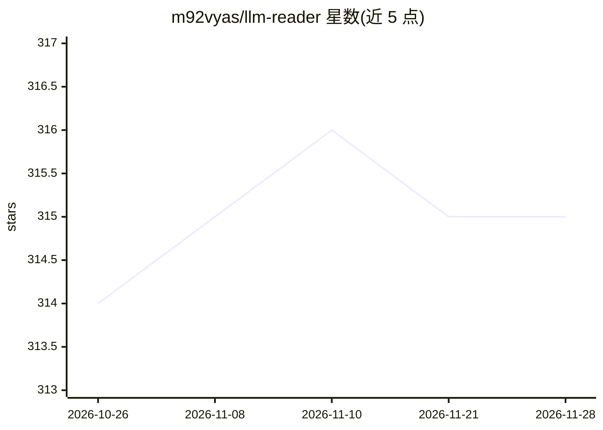

# m92vyas/llm-reader

⭐ 315 · Python · MIT · 推送 2026-11-10 · [GitHub](https://github.com/m92vyas/llm-reader) · 个人维护

**把网页转为 LLM 友好输入文本的 Python 库**

在网页内容交给 LLM 前做预处理：将任意 URL 或 HTML 源码转为 LLM 友好的文本，保留网站/图片链接、表格等结构信息，用于 RAG 与网页抓取场景。基于 Playwright 提供异步/并发抓取（自 Selenium 迁移），支持三种代理配置方式（代码直传、环境变量、配置文件）以及媒体/字体/跟踪器阻断以节省代理流量。通过 pip 从 GitHub 仓库安装，另提供 URL/HTML 转 Markdown 的免费工具。

## 筛选速览

| 维度 | 判定 | 备注 |
|---|---|---|
| AI 角色 | `ai-ecosystem` | LLM/agent 周边工具 |
| 许可风险 | `permissive` | MIT |
| 部署形态 | `library` | 以包/库形式分发 |
| 模型依赖 | — | README 未给出锁定关系 |
| 硬件要求 | — | 无带数字的原话,不猜 |
| 安装摩擦 | `low` | 无编译、无系统依赖或容器化 |
| 成熟度 | — | 结构信号不足 |

## 能力要点

- URL/HTML 到 LLM 友好文本的转换，保留链接与表格结构
- 基于 Playwright 的异步/并发网页抓取
- 三种代理配置方式与环境变量零代码接入
- block_media/block_fonts/block_trackers 省流量选项

## 适用场景

- 为 RAG 流程准备网页内容的 LLM 输入文本
- 抓取电商页面中的产品名、价格、图片链接
- URL 与 HTML 文件批量转 Markdown

## 场景标签

`网页抓取` `RAG` `文档解析` · 领域:效率与自动化

## 证据(README 行号)

> L5: Use this library to turn any webpage/url to LLM friendly text. Fully open source alternative to firecrawl and jina r
> L3: Pre-processing webpage before giving it as input to the LLM improves extraction/scraping accuracy especially if you 

## 星数曲线

2026-10-26 314 → 2026-11-28 315（+1）

---
*卡片 v1 · prompt 1.4 · 生成 2026-11-25 · 置信度 high · 依据 README sha `a6456e15cb14` · [字段定义](../../DATASET.md)*
