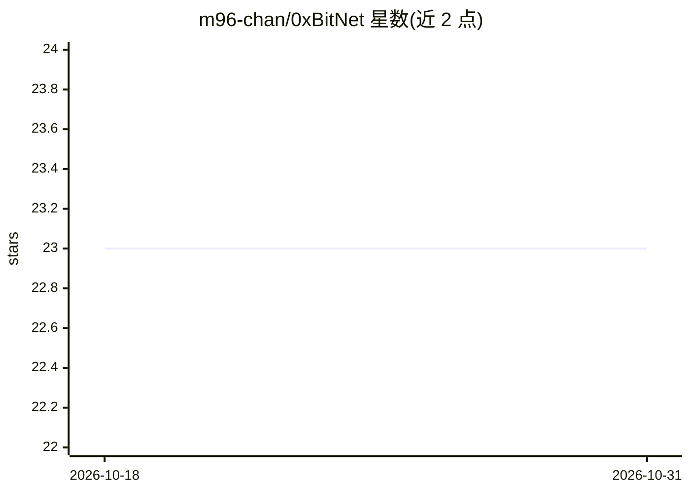

# m96-chan/0xBitNet

⭐ 23 · TypeScript · MIT · 推送 2026-10-23 · [GitHub](https://github.com/m96-chan/0xBitNet) · [官网](https://0xbitnet.m96-chan.dev) · 个人维护

**用 WebGPU 在浏览器与本地 App 运行 BitNet 三值 LLM 的推理库**

0xBitNet 通过自写 WGSL 计算核处理三值矩阵运算，在浏览器、Node.js、Deno 及 wgpu 原生环境（Vulkan/Metal/DX12）中运行 Microsoft BitNet b1.58 等 I2_S GGUF 模型，提供 TypeScript、Rust、Python、Swift、Java、C 六种绑定，支持流式 token 输出、LLaMA 3 聊天模板与自动缓存（IndexedDB/磁盘）。需配备足够显存的专用 GPU，原生路径依赖各语言的工具链版本。

## 筛选速览

| 维度 | 判定 | 备注 |
|---|---|---|
| AI 角色 | `ai-ecosystem` | LLM/agent 周边工具 |
| 许可风险 | `permissive` | MIT |
| 部署形态 | `library` | 以包/库形式分发 |
| 模型依赖 | — | README 未给出锁定关系 |
| 硬件要求 | — | 无带数字的原话,不猜 |
| 安装摩擦 | `high` | 编译与系统依赖俱全 |
| 成熟度 | — | 结构信号不足 |

## 能力要点

- 纯 WebGPU 的 WGSL 三值矩阵计算核，无需 WASM 与服务端
- TypeScript/Rust/Python/Swift/Java/C 六种语言绑定
- 流式生成、聊天模板与 IndexedDB/磁盘自动缓存
- 支持 BitNet b1.58 2B、Falcon-E 1B/3B 等 I2_S GGUF 模型

## 适用场景

- 在网页中无后端地跑 1-bit LLM 聊天
- 在 Node/Deno 或原生应用中嵌入 BitNet 推理
- 离线 TL;DR 摘要小组件
- 跨语言项目中接入三值模型推理

## 场景标签

`推理引擎` · 领域:训练与推理

## 证据(README 行号)

> L13:  Run Microsoft BitNet b1.58 ternary LLMs with WebGPU — in browsers and native apps.
> L17: 0xBitNet runs BitNet b1.58 ternary LLMs on WebGPU. Custom WGSL compute kernels handle the ternary matrix operations
> L21: - **Pure WebGPU** — Custom WGSL kernels for ternary matrix operations (no WASM, no server)

## 星数曲线

2026-10-18 23 → 2026-10-31 23（+0）

---
*卡片 v1 · prompt 1.4 · 生成 2026-10-27 · 置信度 high · 依据 README sha `13d20869e1b0` · [字段定义](../../DATASET.md)*
