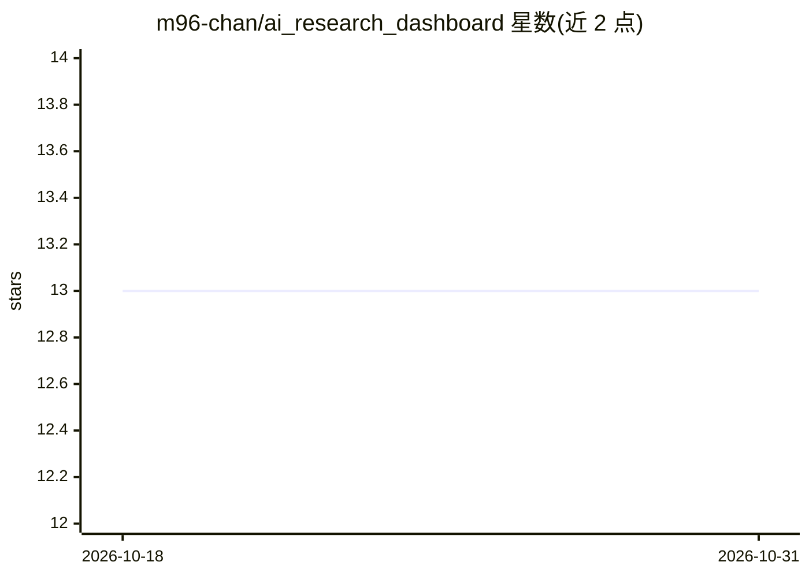

# m96-chan/ai_research_dashboard

⭐ 13 · Astro · MIT · 推送 2026-10-30 · [GitHub](https://github.com/m96-chan/ai_research_dashboard) · [官网](https://ai.m96-chan.dev) · 个人维护

**每小时自动更新的 AI/ML 论文、模型、仓库与新闻聚合面板**

基于 Astro + Tailwind CSS v4 构建的静态面板，通过 GitHub Actions 每 60 分钟抓取 arXiv（cs.AI/cs.LG/cs.CL/cs.CV/stat.ML）最新论文、HuggingFace 趋势模型与数据集、GitHub 新星 AI 仓库、可配置 RSS 新闻（YAML）、Google Trends（美日韩）及 AI 相关股价，并用 OpenAI GPT-4o-mini 生成日语 TL;DR 摘要。部署于 GitHub Pages，本地运行需 pnpm 安装并设置 OPENAI_API_KEY 才能生成摘要，摘要生成会产生 API 费用。

## 筛选速览

| 维度 | 判定 | 备注 |
|---|---|---|
| AI 角色 | `ai-knowledge` | 知识聚合/清单类 |
| 许可风险 | `permissive` | MIT |
| 部署形态 | `library` | 以包/库形式分发 |
| 模型依赖 | — | README 未给出锁定关系 |
| 硬件要求 | — | 无带数字的原话,不猜 |
| 安装摩擦 | `low` | 无编译、无系统依赖或容器化 |
| 成熟度 | — | 结构信号不足 |

## 能力要点

- 聚合 arXiv、HuggingFace、GitHub、RSS、Google Trends、股价六类数据源
- GitHub Actions 每 60 分钟 cron 自动更新
- GPT-4o-mini 生成日语 TL;DR 摘要
- RSS 源通过 config/feeds.yml 以 YAML 配置

## 适用场景

- 在一个页面上跟踪每日 AI 论文、模型与仓库动态
- 关注日本及全球 AI 新闻、硬件与安全资讯
- 查看 AI 相关股价与各国科技热词趋势

## 场景标签

`精选清单` `科研工具` · 领域:学习与行业

## 证据(README 行号)

> L5:  A curated dashboard for the latest AI/ML papers, models, repos, trends, and news.
> L16: |Source|Description / 説明|
> L18: |**arXiv**|Latest papers from cs.AI, cs.LG, cs.CL, cs.CV, stat.ML / AI 関連の最新論文|

## 星数曲线

2026-10-18 13 → 2026-10-31 13（+0）

---
*卡片 v1 · prompt 1.4 · 生成 2026-10-31 · 置信度 high · 依据 README sha `3bbfaced7289` · [字段定义](../../DATASET.md)*
