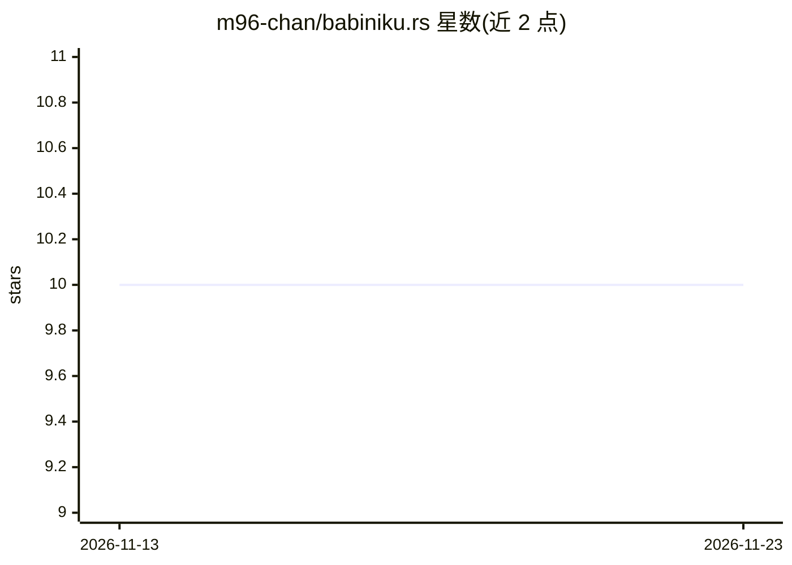

# m96-chan/babiniku.rs

⭐ 10 · Rust · Apache-2.0 · 推送 2026-11-06 · [GitHub](https://github.com/m96-chan/babiniku.rs) · 个人维护

**VTuber 实时零样本变声工具箱：纯 Rust 虚拟麦克风**

纯 Rust 实现的实时零样本变声工具链：输入几秒参考音频即可在 CPU 上进行实时语音转换，通过虚拟麦克风向 Discord/Zoom/OBS 等任何可选麦克风的应用输出角色嗓音。内置 MeanVC、X-VC、Seed-VC、CosyVoice2、Vevo-Timbre 五个引擎，提供 TUI 实时调节音高、降噪、带宽扩展等参数，48 kHz 输出，语音全程本地处理。安装依赖 Rust 工具链，部分引擎的实时麦克风需要 GPU；seedvc feature 使分发版本变为 GPL-3.0。

## 筛选速览

| 维度 | 判定 | 备注 |
|---|---|---|
| AI 角色 | `ai-native` | 本体是模型或模型工具 |
| 许可风险 | `permissive` | Apache-2.0 |
| 部署形态 | `library` | 以包/库形式分发 |
| 模型依赖 | — | README 未给出锁定关系 |
| 硬件要求 | — | 无带数字的原话,不猜 |
| 安装摩擦 | `medium` | 含编译或系统依赖之一 |
| 成熟度 | — | 结构信号不足 |

## 能力要点

- CPU 实时基线：无 Python、无 CUDA Toolkit、无云端，语音不离开本机
- 虚拟麦克风 48 kHz 输出，纯 DSP 谐波激励器补全 8–16 kHz 频带且零额外延迟
- 五个可切换引擎，权重与官方实现对齐并经 golden test 逐步验证
- TUI 运行中实时调节音高/降噪/门限/EQ，显示各引擎 RTF

## 适用场景

- VTuber 直播中保持角色声音，包括即兴连麦
- 会议和 Discord 中以角色声音发言
- 游戏语音中向队友隐藏真实声音
- 需要声音隐私的公开场合发言

## 场景标签

 · 领域:音频/实时语音处理

## 证据(README 行号)

> L12: babiniku.rs is the missing last mile: a **real-time zero-shot voice changer toolkit in pure Rust**. Give it a few s
> L66: - **VTuber / streaming** — stay in character on stream, including impromptu collabs.

## 星数曲线

2026-11-13 10 → 2026-11-23 10（+0）

---
*卡片 v1 · prompt 1.4 · 生成 2026-11-19 · 置信度 high · 依据 README sha `2959977ed877` · [字段定义](../../DATASET.md)*
