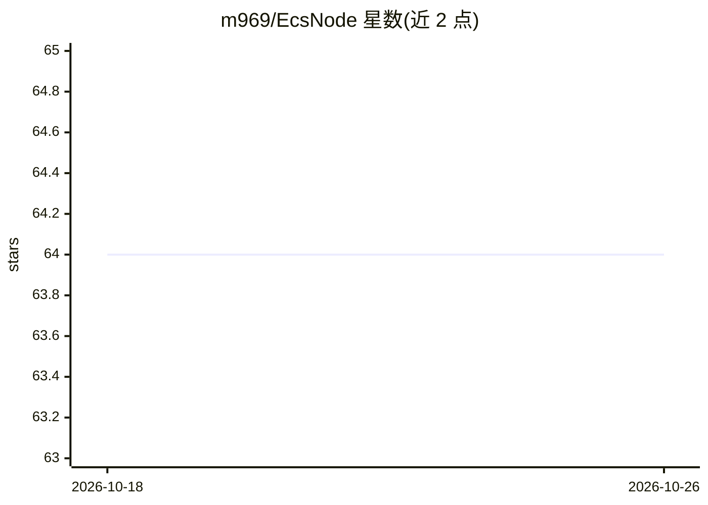

# m969/EcsNode

⭐ 64 · C# · MIT · 推送 2026-03-11 · [GitHub](https://github.com/m969/EcsNode) · 个人维护 · 中文 README

**支持热重载的 C# ECS 游戏框架，含 AI 辅助模块开发流程**

基于 Entity-Component-System 模式的 Unity/C# 框架，主张数据/逻辑/视图分离，采用域-层-块三级目录管理与领域驱动设计划分模块。提供作用域限定的事件机制（顶层接口事件、系统接口事件）、逻辑热重载与基于 FGUI 的 UI 热更新，并附 SLG 游戏 Demo 与帧同步方案（其一已实现）。AI 部分为规范化的 Spec-Modular-Driven 模块开发流：以 copilot-instruction.md 及需求/设计/API 文档配合 Copilot、Claude、Cursor 等生成功能模块。README 未给出安装命令。

## 筛选速览

| 维度 | 判定 | 备注 |
|---|---|---|
| AI 角色 | `ai-enhanced` | 去掉 AI 部分产品仍成立 |
| 许可风险 | `permissive` | MIT |
| 部署形态 | `None` |  |
| 模型依赖 | — | README 未给出锁定关系 |
| 硬件要求 | — | 无带数字的原话,不猜 |
| 安装摩擦 | `low` | 无编译、无系统依赖或容器化 |
| 成熟度 | `idea` | |

## 能力要点

- ECS 数据/逻辑/视图分离，支持逻辑热重载
- 域-层-块三级目录管理与 ECS 域划分
- 作用域限定的事件机制（EventBus 顶层事件 + 接口事件）
- 基于 copilot-instruction.md 的 AI 辅助模块开发流程（Spec-Modular-Driven）

## 适用场景

- Unity 游戏开发中用 ECS 组织业务逻辑并热重载调试
- 以规范化文档驱动 AI 生成可维护的功能模块
- 搭建 SLG 或帧同步类游戏的模块化架构

## 场景标签

`代码生成` · 领域:编码与开发

## 证据(README 行号)

> L36: - **规范化模块开发流 (AI+)**
> L91: 基于前面清晰规范的 层级模块目录、Ecs模式以及事件机制，使用AI生成可维护可扩展的功能模块。
> L93: 基于 `copilot-instruction.md` (自然语言描述的说明文档，适用于 Copilot, Claude, Cursor 等)。

## 星数曲线

2026-10-18 64 → 2026-10-26 64（+0）

---
*卡片 v1 · prompt 1.4 · 生成 2026-10-24 · 置信度 high · 依据 README sha `d8ab83500355` · [字段定义](../../DATASET.md)*
