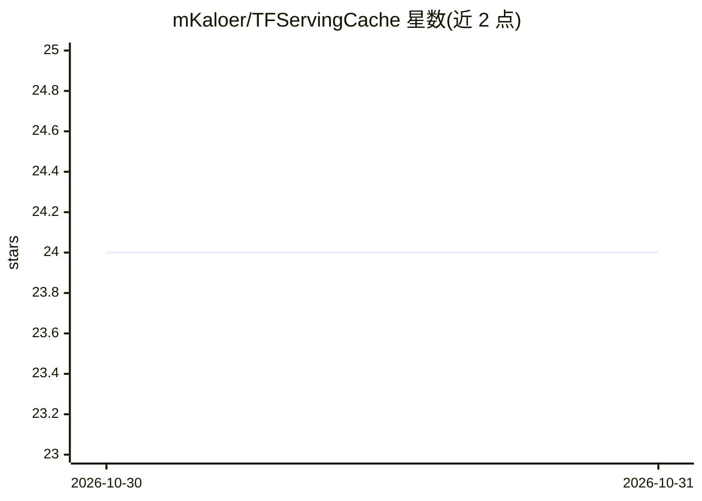

# mKaloer/TFServingCache

⭐ 24 · Go · Apache-2.0 · 推送 2026-10-30 · [GitHub](https://github.com/mKaloer/TFServingCache) · 个人维护

**TF Serving 的分布式模型缓存与负载均衡器，按需加载卸载模型**

面向需要在多个 TensorFlow Serving 服务上服务大量模型的场景（如每个租户各有一个模型）。作为代理层实现 TF Serving predict 协议（REST 与 gRPC），客户端无需修改。收到请求时按一致性哈希选定 TF Serving 服务，模型未加载则从磁盘、AWS S3 或 Azure Blob 拉取并加载，同时按 LRU 卸载最近最少使用的模型。支持 etcd、Consul、Kubernetes 服务发现，节点可动态伸缩。README 声明为 work-in-progress，未给出安装运行命令。

## 筛选速览

| 维度 | 判定 | 备注 |
|---|---|---|
| AI 角色 | `ai-ecosystem` | LLM/agent 周边工具 |
| 许可风险 | `permissive` | Apache-2.0 |
| 部署形态 | `None` |  |
| 模型依赖 | — | README 未给出锁定关系 |
| 硬件要求 | — | 无带数字的原话,不猜 |
| 安装摩擦 | `low` | 无编译、无系统依赖或容器化 |
| 成熟度 | `idea` | |

## 能力要点

- 实现 TF Serving predict 协议（REST/gRPC），客户端无需修改
- 一致性哈希分布模型，支持每模型多副本
- Just-In-Time 模型加载与 LRU 卸载
- 模型源支持磁盘 / AWS S3 / Azure Blob，服务发现支持 etcd/Consul/K8s

## 适用场景

- 为多租户各持有自有模型的场景服务大量模型
- 降低全部模型同时驻留内存的 TF Serving 部署成本
- 在不改动客户端的情况下为 TF Serving 集群加缓存层

## 场景标签

`推理引擎` · 领域:训练与推理

## 证据(README 行号)

> L3: TF Serving load balancer/model cache that dynamically loads and unloads models into TensorFlow Serving services on d
> L19: TF Serving Cache distributes the models among a number of TensorFlow Serving services, each providing at most `N` m

## 星数曲线

2026-10-30 24 → 2026-10-31 24（+0）

---
*卡片 v1 · prompt 1.4 · 生成 2026-10-30 · 置信度 high · 依据 README sha `58b46acfd276` · [字段定义](../../DATASET.md)*
