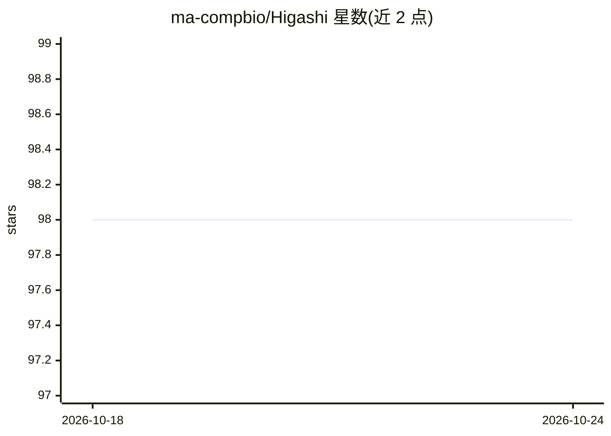

# ma-compbio/Higashi

⭐ 98 · Jupyter Notebook · MIT · 推送 2025-10-29 · [GitHub](https://github.com/ma-compbio/Higashi) · 组织维护

**单细胞 Hi-C 分析框架：超图神经网络嵌入与接触图填补**

面向单细胞 Hi-C（scHi-C）数据的计算框架：将数据集表示为超图（细胞节点、基因组 bin 节点、染色质交互作为超边），用超图神经网络揭示高阶交互模式，产出细胞嵌入用于下游分析，并支持填补单细胞接触图，以在单细胞分辨率刻画 TAD-like 结构域边界与 A/B compartment 分数。安装方式为 conda（Fast-Higashi）或从源码 setup.py 安装，建议配置 PyTorch（含 CUDA）。附论文（Nature Biotechnology）与 wiki 文档、多个数据集教程。

## 筛选速览

| 维度 | 判定 | 备注 |
|---|---|---|
| AI 角色 | `ai-native` | 本体是模型或模型工具 |
| 许可风险 | `permissive` | MIT |
| 部署形态 | `None` |  |
| 模型依赖 | — | README 未给出锁定关系 |
| 硬件要求 | — | 无带数字的原话,不猜 |
| 安装摩擦 | `medium` | 含编译或系统依赖之一 |
| 成熟度 | — | 结构信号不足 |

## 能力要点

- 超图表示 scHi-C 数据（细胞/bin 节点 + 接触超边）
- 超图神经网络学习高阶交互模式
- 生成细胞嵌入用于下游分析
- 填补单细胞 Hi-C 接触图，刻画 TAD-like 边界与 A/B compartment 分数

## 适用场景

- 对单细胞 Hi-C 数据做嵌入与聚类等下游分析
- 填补稀疏的单细胞接触图以提取 3D 基因组特征
- 在 4DN sci-Hi-C、Ramani 等公开数据集上复现分析

## 场景标签

 · 领域:生物信息学/3D 基因组

## 证据(README 行号)

> L7: As a computational framework for scHi-C analysis, Higashi has the following features:
> L13: - Higashi uses a **hypergraph neural network** to unveil high-order interaction patterns within this constructed hy
> L15: - Higashi can **impute single-cell Hi-C contact maps**, enabling detailed characterization of 3D genome features su

## 星数曲线

2026-10-18 98 → 2026-10-24 98（+0）

---
*卡片 v1 · prompt 1.4 · 生成 2026-10-23 · 置信度 high · 依据 README sha `95a8cd8bd475` · [字段定义](../../DATASET.md)*
