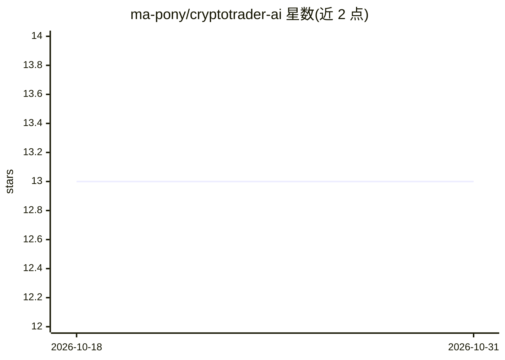

# ma-pony/cryptotrader-ai

⭐ 13 · Python · MIT · 推送 2026-09-10 · [GitHub](https://github.com/ma-pony/cryptotrader-ai) · [官网](https://github.com/ma-pony/cryptotrader-ai#readme) · 个人维护 · 中文 README

**加密货币多信号融合与多平台自动交易、回测系统**

可插拔的加密资产信号融合与执行系统：Kronos 模型、LLM 四智能体委员会辩论和自定义组件作为独立信号来源，按网页可调信任权重融合为目标仓位，再由各执行资金池（Paper/模拟/实盘隔离）独立风控、可选 HITL 审批后执行。配置唯一存于数据库 runtime_config，凭据用 AES-GCM 主密钥加密。回测仅用临时 Paper 资金池；实盘连接仅允许只读检查，禁止自动化真实资金订单。要求 Python 3.12+、Node.js 20+、PostgreSQL、uv 与 pnpm，支持 Compose 容器启动。

## 筛选速览

| 维度 | 判定 | 备注 |
|---|---|---|
| AI 角色 | `ai-native` | 本体是模型或模型工具 |
| 许可风险 | `permissive` | MIT |
| 部署形态 | `self-host` | docker 或自建部署 |
| 模型依赖 | — | README 未给出锁定关系 |
| 硬件要求 | — | 无带数字的原话,不猜 |
| 安装摩擦 | `low` | 无编译、无系统依赖或容器化 |
| 成熟度 | — | 结构信号不足 |

## 能力要点

- Kronos、LLM 四智能体委员会、自定义组件的信号融合机制
- 每资金池独立风控与 HITL 审批，配置 revision 冻结
- 回测限定临时 Paper 资金池，实盘连接仅只读检查
- 金丝雀验收脚本：严格锁内最小仓位闭环与零残留审计

## 适用场景

- 我想在模拟盘验证多模型融合的加密货币交易策略
- 我需要带硬性风控和人工审批（HITL）的自动交易执行系统
- 我回测策略时不想触碰真实资金，仅用 Paper 资金池
- 我要求每笔决策有完整周期审计日志可查

## 场景标签

`金融量化` `多智能体` · 领域:Agent 开发

## 证据(README 行号)

> L3: CryptoTrader AI 是一个可插拔的加密资产信号融合与多平台执行系统。Kronos、LLM 四智能体委员会和自定义组件都是独立信号来源；它们以网页可调整的信任权重融合为一个目标仓位，再由各执行资金池独立风控、审批和执行。
> L12: 市场数据 → Kronos / 四智能体内部辩论 / 自定义组件 → 信号融合 → 目标仓位

## 星数曲线

2026-10-18 13 → 2026-10-31 13（+0）

---
*卡片 v1 · prompt 1.4 · 生成 2026-10-31 · 置信度 mid · 依据 README sha `06e313638ed0` · [字段定义](../../DATASET.md)*
