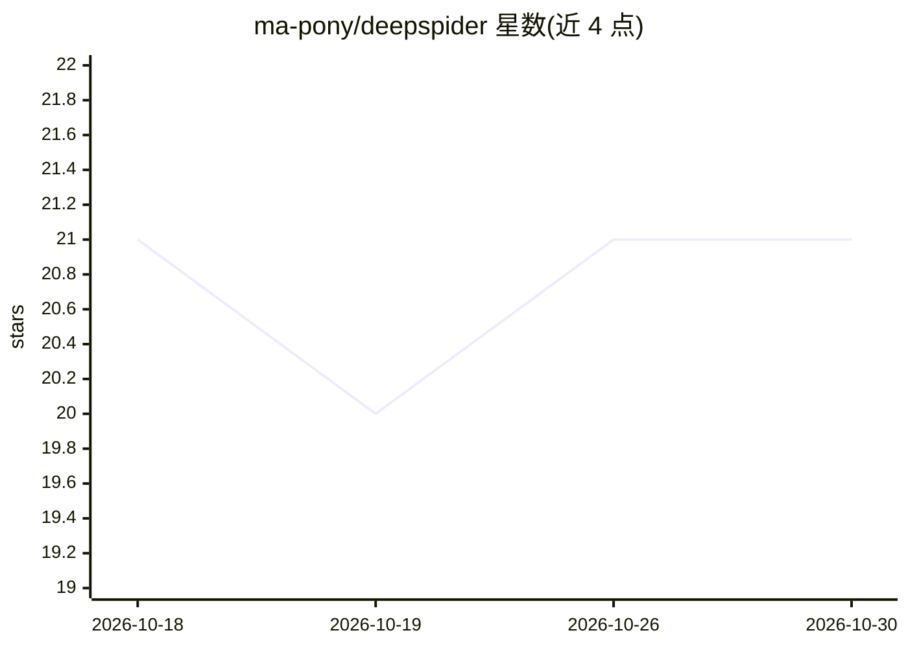

# ma-pony/deepspider

⭐ 21 · JavaScript · 推送 2026-09-18 · [GitHub](https://github.com/ma-pony/deepspider) · 个人维护 · 中文 README

**AI 驱动的爬虫与 JS 逆向平台，从浏览器证据恢复参数生成逻辑**

面向逆向工程师与爬虫开发者的工作台：用 Patchright Chromium + CDP 采集请求、脚本与运行时事实，构建 Artifact Graph 与 Output Contract，再由独立 Node 语义运行时（sdenv Worker）重新生成目标输出，并通过 CycleTLS 真实请求验证，最终导出可脱离浏览器重跑的 Solver。关键限制：首版端到端自动恢复仅支持 Cookie；Header、Query、Body 等类型保留证据与手工分析能力，不宣称自动 reproduced。以 npm 全局包或 DSH 插件形式提供，另带 stdio MCP 适配器。

## 筛选速览

| 维度 | 判定 | 备注 |
|---|---|---|
| AI 角色 | `ai-native` | 本体是模型或模型工具 |
| 许可风险 | `permissive` | — |
| 部署形态 | `library` | 以包/库形式分发 |
| 模型依赖 | — | README 未给出锁定关系 |
| 硬件要求 | — | 无带数字的原话,不猜 |
| 安装摩擦 | `low` | 无编译、无系统依赖或容器化 |
| 成熟度 | — | 结构信号不足 |

## 能力要点

- Browser Oracle → Contract → Runtime Recipe → sdenv Worker → 真实请求验证 → Solver 的输出驱动链路
- 三级证据等级（observed/replayed/reproduced），浏览器捕获值不作为完成证据
- 首版自动语义恢复仅支持 Cookie，其他输出类型不宣称自动 reproduced
- 提供 stdio MCP 外部适配器与多 Session 并行（浏览器、Worker、产物相互隔离）

## 适用场景

- 逆向分析动态参数（如 Cookie）的生成逻辑并导出可独立运行的 Solver
- 定位混淆/Webpack/Worker 代码中的参数写入边界
- 通过 MCP 将爬虫逆向工具目录接入其他客户端

## 场景标签

`网页抓取` · 领域:效率与自动化

## 证据(README 行号)

> L6: > AI 原生的智能爬虫与 JavaScript 逆向工程平台——基于 DSH、Patchright/CDP 与独立语义运行时，从浏览器证据恢复参数生成逻辑，并交付经过真实请求验证的可运行 Solver。
> L8: DeepSpider 将 DSH Web、Patchright Chromium、Chrome DevTools Protocol（CDP）和独立 Node 语义运行时组合成一套逆向工作台。浏览器负责采集请求、脚本与运行时事实；最终
> L93: 能力注册表将 Evidence Selector、Engine、Output Adapter、Validator 和 Exporter 组合成可执行链；只有五类组件都存在的输出类型才会发布到工具 schema。当前 Cookie 

## 星数曲线

2026-10-18 21 → 2026-10-30 21（+0）

---
*卡片 v1 · prompt 1.4 · 生成 2026-10-28 · 置信度 high · 依据 README sha `733e2b217eaa` · [字段定义](../../DATASET.md)*
