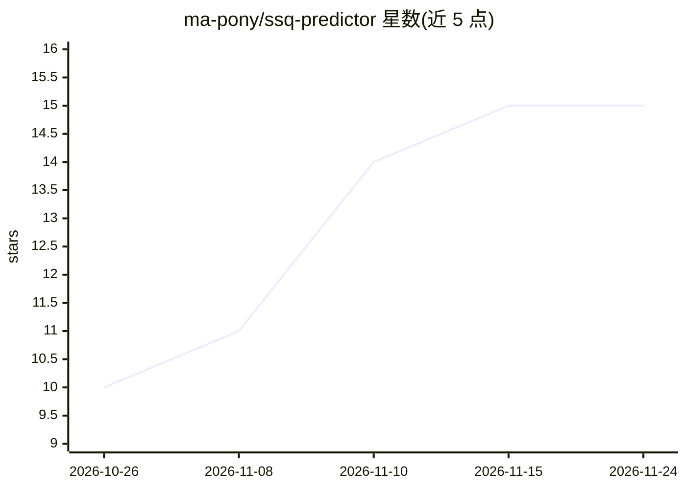

# ma-pony/ssq-predictor

⭐ 15 · Python · 推送 2026-02-07 · [GitHub](https://github.com/ma-pony/ssq-predictor) · 个人维护 · 中文 README

**双色球彩票预测 Agent Skill：统计/物理/易经多维选号分析**

面向支持 Agent Skill 的编辑器（Claude Code、Cursor、Windsurf、Codex CLI）的双色球预测分析技能，以 SKILL.md 为入口。功能包括基于出生日期的生肖/八字/喜用神个人化分析、概率统计与热号冷号研判、梅花易数起卦，以及自动获取 2003 年至今 3400+ 期开奖数据（来源 tubiao.zhcw.com，带备份、验证与 3 次重试机制）。提供人工安装与 Agent 自动安装两套指南，README 附免责声明：开奖完全随机，仅供娱乐参考。

## 筛选速览

| 维度 | 判定 | 备注 |
|---|---|---|
| AI 角色 | `ai-native` | 本体是模型或模型工具 |
| 许可风险 | `none` | — |
| 部署形态 | `None` |  |
| 模型依赖 | — | README 未给出锁定关系 |
| 硬件要求 | — | 无带数字的原话,不猜 |
| 安装摩擦 | `low` | 无编译、无系统依赖或容器化 |
| 成熟度 | — | 结构信号不足 |

## 能力要点

- 以 SKILL.md 定义的 Agent Skill，兼容 4 种编辑器
- 自动获取并更新 2003 年至今 3400+ 期开奖数据
- 概率统计、物理学、易经玄学三维度分析
- 提供人工安装与 Agent 自动安装两套流程

## 适用场景

- 在 Claude Code 等编辑器中用对话触发双色球选号分析
- 基于个人生日信息生成个性化彩票号码推荐
- 维护和更新双色球历史开奖数据

## 场景标签

 · 领域:娱乐/彩票预测

## 证据(README 行号)

> L3: 中国福利彩票双色球号码预测分析技能，融合数理统计与传统智慧。
> L17: ├── SKILL.md              # 技能定义文件（Agent 入口）
> L27: - 支持 Agent Skill 的编辑器（Claude Code、Cursor、Windsurf、Codex CLI 等）

## 星数曲线

2026-10-26 10 → 2026-11-24 15（+5）

---
*卡片 v1 · prompt 1.4 · 生成 2026-11-18 · 置信度 high · 依据 README sha `23c9d0257b5f` · [字段定义](../../DATASET.md)*
