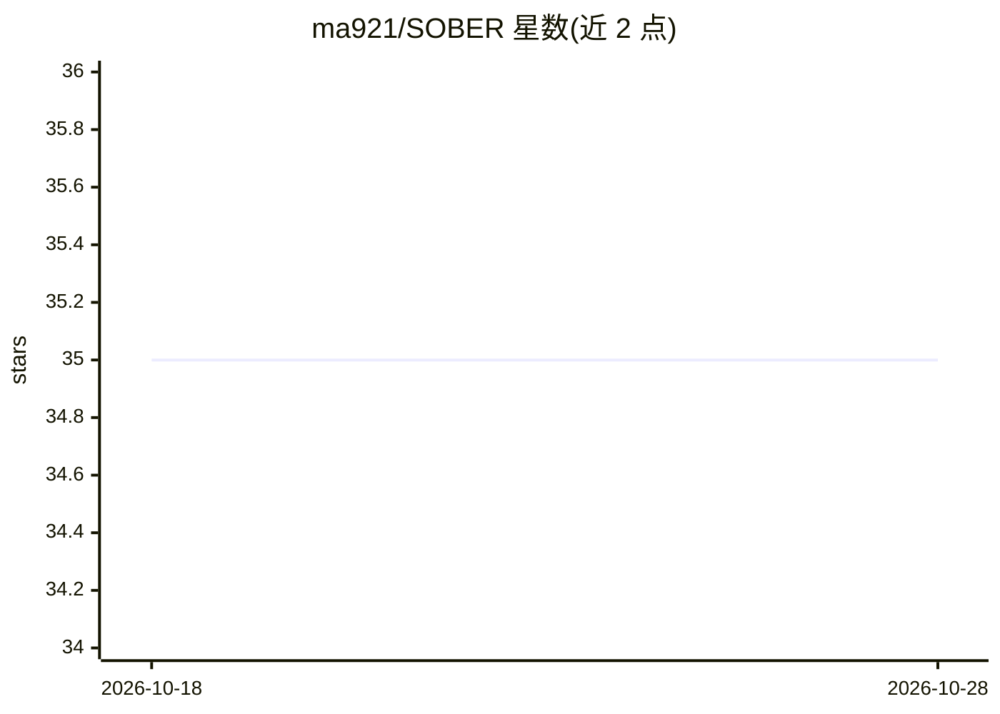

# ma921/SOBER

⭐ 35 · Jupyter Notebook · BSD-3-Clause · 推送 2025-12-10 · [GitHub](https://github.com/ma921/SOBER) · 个人维护

**面向研究者的快速贝叶斯优化/求积/推断 Python 库，GPU 并行**

基于 GPyTorch 与 BoTorch 实现的批处理贝叶斯优化、贝叶斯求积与贝叶斯推断库，核心机制是将批处理全局优化转化为贝叶斯求积问题，通过最小化概率测度 π 下的积分误差选择批查询位置。支持任意域空间（连续、离散、混合或数据集形式）、任意核函数与先验分布，提供 GPU 并行加速。面向从业者与研究人员，附教程、论文复现示例及药物发现应用指引。安装需从 Releases 下载 .whl 或从源码构建，依赖 PyTorch/GPyTorch/BoTorch。

## 筛选速览

| 维度 | 判定 | 备注 |
|---|---|---|
| AI 角色 | `ai-native` | 本体是模型或模型工具 |
| 许可风险 | `permissive` | BSD-3-Clause |
| 部署形态 | `library` | 以包/库形式分发 |
| 模型依赖 | — | README 未给出锁定关系 |
| 硬件要求 | — | 无带数字的原话,不猜 |
| 安装摩擦 | `low` | 无编译、无系统依赖或容器化 |
| 成熟度 | — | 结构信号不足 |

## 能力要点

- 批贝叶斯优化/求积/推断三合一，GPU 并行加速
- 支持任意域空间（连续/离散/混合/数据集）与任意核、采集函数、先验
- 基于期望传播的特征级贝叶斯优化与 GP 逆建模代理
- 论文在 12 个任务上与 11 个基线对比并提供复现示例

## 适用场景

- 黑箱函数的样本高效全局优化（含药物发现场景）
- 仿真式推断与贝叶斯推断任务
- 快速全贝叶斯高斯过程建模与主动学习

## 场景标签

 · 领域:机器学习/优化

## 证据(README 行号)

> L3: Fast Bayesian optimization, quadrature, inference over arbitrary domain (discrete and mixed spaces) with GPU paralle
> L18: - fast batch Bayesian optimization

## 星数曲线

2026-10-18 35 → 2026-10-28 35（+0）

---
*卡片 v1 · prompt 1.4 · 生成 2026-10-25 · 置信度 mid · 依据 README sha `56cbc77c55fd` · [字段定义](../../DATASET.md)*
