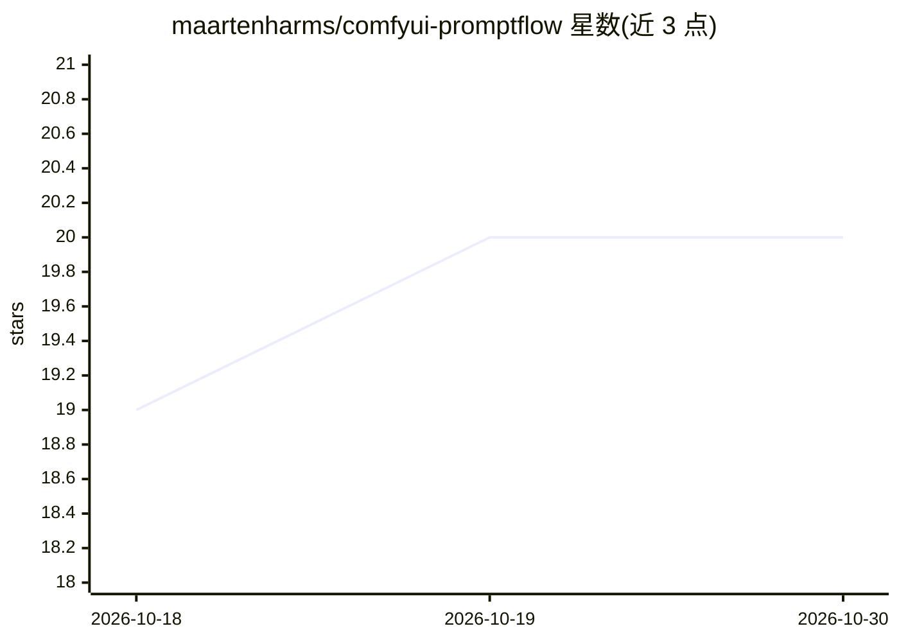

# maartenharms/comfyui-promptflow

⭐ 20 · JavaScript · MIT · 推送 2026-02-05 · [GitHub](https://github.com/maartenharms/comfyui-promptflow) · 个人维护

**ComfyUI 提示词工程自定义节点：通配符、预设与自动分类**

免费开源的 ComfyUI 自定义节点，面向 Stable Diffusion 图像生成用户的提示词组织：提供 Simple（3 字段）与 Extended（11 字段）两种模式，支持 {a|b|c} 内联通配符与 __file__ 文件通配符（Fixed/Random/Increment/Decrement 四种字段模式）、Variations 节点预览全部组合并批量排队、Auto-Sort 粘贴提示词后按 200+ 关键词自动分类、22 个内置预设与自定义预设导出导入，并可接入 LoRA Manager 自动前置触发词。通过 ComfyUI Manager、git clone 或手动下载安装。

## 筛选速览

| 维度 | 判定 | 备注 |
|---|---|---|
| AI 角色 | `ai-ecosystem` | LLM/agent 周边工具 |
| 许可风险 | `permissive` | MIT |
| 部署形态 | `None` |  |
| 模型依赖 | — | README 未给出锁定关系 |
| 硬件要求 | — | 无带数字的原话,不猜 |
| 安装摩擦 | `low` | 无编译、无系统依赖或容器化 |
| 成熟度 | — | 结构信号不足 |

## 能力要点

- Simple/Extended 双模式（3 与 11 字段）结构化提示词
- 内联与文件通配符，4 种字段选择模式，Variations 节点预览组合并批量排队
- Auto-Sort 按 200+ 关键词自动分类粘贴的提示词
- 22 个内置预设与 LoRA Manager 触发词集成

## 适用场景

- 在 ComfyUI 中结构化组织正负向提示词
- 用通配符批量生成和挑选提示词组合
- 复用预设与触发词快速搭建生成工作流

## 场景标签

`提示工程` · 领域:Agent 开发

## 证据(README 行号)

> L25: **PromptFlow** is a **free and open source** ComfyUI custom node that organizes your prompt workflow. Build structu
> L27: - 📝 **Two Modes** - Simple (3 fields) or Extended (11 fields) for any workflow

## 星数曲线

2026-10-18 19 → 2026-10-30 20（+1）

---
*卡片 v1 · prompt 1.4 · 生成 2026-10-28 · 置信度 high · 依据 README sha `a66ed974f8ba` · [字段定义](../../DATASET.md)*
