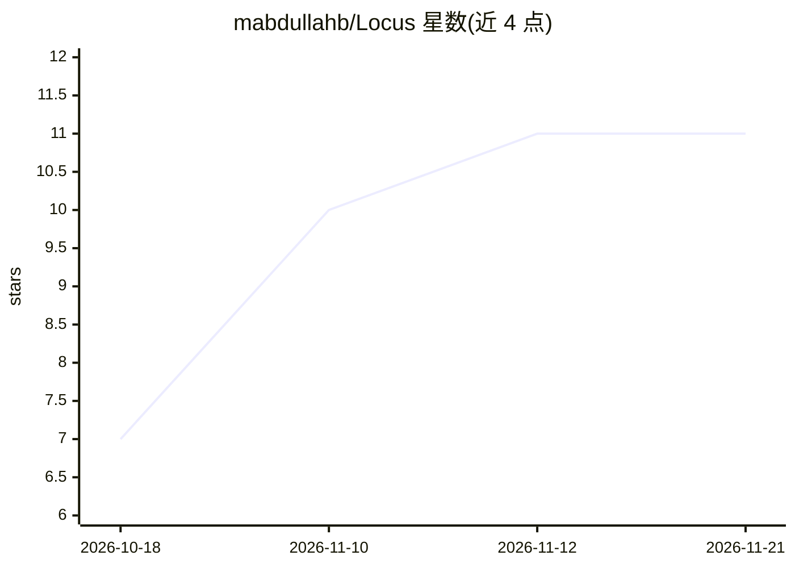

# mabdullahb/Locus

⭐ 11 · TypeScript · AGPL-3.0 · 推送 2026-09-15 · [GitHub](https://github.com/mabdullahb/Locus) · [官网](https://cloudzcomputing.com/software-products) · 个人维护

**自托管 Google Maps 商户线索抓取与 AI 邮件富集工具**

基于 Next.js + Prisma + Postgres + BullMQ/Redis 的自托管流水线：按地点与类别抓取 Google Maps 商户列表，经 LLM 富集步骤从商户网站寻找并核验联系邮箱，再做 MX 查询与 SMTP 握手的真实邮箱验证；结果表支持筛选、排序、CSV/Excel/JSON 导出、webhook 与 HubSpot/Salesforce 连接器。要求自备搜索 API key（SerpApi/Serper.dev/Google Places）与 AI key（Gemini/OpenAI/Anthropic/OpenRouter），无托管版，完全自行部署。README 提示抓取 Google Maps 违反其服务条款，仅供研究教育用途。

## 筛选速览

| 维度 | 判定 | 备注 |
|---|---|---|
| AI 角色 | `ai-enhanced` | 去掉 AI 部分产品仍成立 |
| 许可风险 | `viral` | AGPL-3.0 |
| 部署形态 | `self-host` | docker 或自建部署 |
| 模型依赖 | — | README 未给出锁定关系 |
| 硬件要求 | — | 无带数字的原话,不猜 |
| 安装摩擦 | `low` | 无编译、无系统依赖或容器化 |
| 成熟度 | — | 结构信号不足 |

## 能力要点

- 按地点/类别/半径抓取 Google Maps 商户并经 WebSocket 实时显示进度
- LLM 邮箱富集 + MX/SMTP 真实验证，可选 Hunter.io 前置查询
- CSV 批量任务（单次最多 50 组查询）与跨会话商户去重合并
- Docker Compose 一键栈（app/worker/Postgres/Redis），历史会话快照与对比

## 适用场景

- 为销售团队按区域和行业批量收集商户线索
- 抓取联系邮箱并验证后导入 HubSpot/Salesforce CRM
- 自托管环境下的本地线索挖掘与多次搜索结果对比

## 场景标签

`网页抓取` · 领域:效率与自动化

## 证据(README 行号)

> L13: Locus runs a pipeline: search a place and a category, pull the matching
> L33: - **AI enrichment**: each business gets run through an LLM step that tries to
> L51: - **Bring your own key, for everything**: search provider, AI provider,

## 星数曲线

2026-10-18 7 → 2026-11-21 11（+4）

---
*卡片 v1 · prompt 1.4 · 生成 2026-11-18 · 置信度 high · 依据 README sha `968d75066b5d` · [字段定义](../../DATASET.md)*
