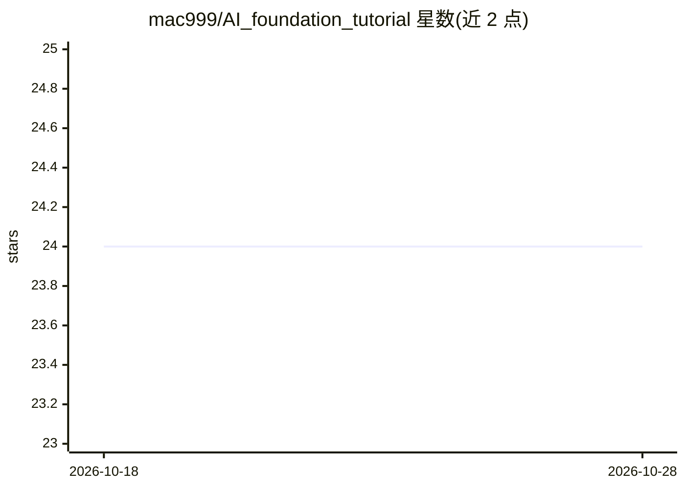

# mac999/AI_foundation_tutorial

⭐ 24 · Jupyter Notebook · MIT · 推送 2026-04-06 · [GitHub](https://github.com/mac999/AI_foundation_tutorial) · 个人维护

**AI 基础与趋势研讨课教程：代码+幻灯片+实训材料**

面向研讨课学习者的 AI 基础教程仓库，覆盖 AI/ML/DL/NLP/Transformer/LLM 概念与代码，以 Jupyter Notebook 为主提供动手实践。内容分八个目录（AX 趋势、ML 基础、DL 基础、NLP、Transformer、LLM Agent 与 vibe coding、AI 服务、参考），并附 PDF 幻灯片、教学大纲与课程计划。扩展方向包括 LLM/RAG/Agent/MCP 开发、用 PyTorch/Keras 从零实现 CNN/ResNet/YOLO、多模态（ViT/CLIP）与 AI 媒体艺术。环境搭建涉及 Colab、Anaconda、PyTorch、Ollama 等工具与多项付费 AI 服务账号。

## 筛选速览

| 维度 | 判定 | 备注 |
|---|---|---|
| AI 角色 | `ai-knowledge` | 知识聚合/清单类 |
| 许可风险 | `permissive` | MIT |
| 部署形态 | `library` | 以包/库形式分发 |
| 模型依赖 | — | README 未给出锁定关系 |
| 硬件要求 | — | 无带数字的原话,不猜 |
| 安装摩擦 | `medium` | 含编译或系统依赖之一 |
| 成熟度 | — | 结构信号不足 |

## 能力要点

- 八个主题目录组织 ML/DL/NLP/Transformer/LLM 教程代码
- 从零实现 CNN、ResNet、R-CNN、YOLO 等模型的动手练习（PyTorch/Keras）
- 涵盖 LLM、RAG、AI Agent 与 MCP 的开发课程
- 附 PDF 幻灯片、教学大纲与课程计划文档

## 适用场景

- 系统学习从 ML 基础到 Transformer/LLM 的概念与代码
- 跟着 Notebook 动手实现 CV 与多模态模型
- 学习用 LLM、RAG 与 MCP 开发 AI agent

## 场景标签

`教程课程` · 领域:学习与行业

## 证据(README 行号)

> L3: This repository contains materials for an AI Foundation seminar(English version.pdf)) with syllabus, covering fundam
> L5: - How to develop AI agent with LLM: This repository contains LLM(large language model), RAG(retrieval augmented gene
> L12: The repository is organized into several folders, each focusing on a specific area of AI, along with supplementary 

## 星数曲线

2026-10-18 24 → 2026-10-28 24（+0）

---
*卡片 v1 · prompt 1.4 · 生成 2026-10-27 · 置信度 high · 依据 README sha `e267f61e85cb` · [字段定义](../../DATASET.md)*
