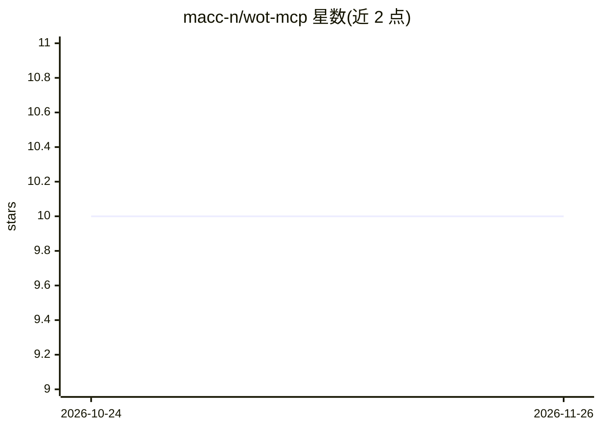

# macc-n/wot-mcp

⭐ 10 · TypeScript · GPL-3.0 · 推送 2026-02-04 · [GitHub](https://github.com/macc-n/wot-mcp) · 个人维护

**把 WoT 物联网设备以 MCP 暴露给 AI 助手的服务器**

该服务器应用将 Web of Things 设备模型（Properties、Actions、Events）翻译为 MCP 原语（Resources 与 Tools），使支持 MCP 的 AI 客户端可直接发现、监视和控制物理设备。提供 explicit 与 generic 两种工具生成策略、stdio 与 streamable-http 两种传输模式、事件缓冲，支持 HTTP、CoAP、MQTT 设备接入，提供 Dockerfile 与 npm 构建/启动命令。首版未包含认证、安全机制与持久化存储。

## 筛选速览

| 维度 | 判定 | 备注 |
|---|---|---|
| AI 角色 | `ai-ecosystem` | LLM/agent 周边工具 |
| 许可风险 | `viral` | GPL-3.0 |
| 部署形态 | `self-host` | docker 或自建部署 |
| 模型依赖 | — | README 未给出锁定关系 |
| 硬件要求 | — | 无带数字的原话,不猜 |
| 安装摩擦 | `low` | 无编译、无系统依赖或容器化 |
| 成熟度 | `idea` | |

## 能力要点

- 将 WoT 的 Properties/Actions/Events 翻译为 MCP Resources 与 Tools
- explicit（每能力一个工具）与 generic（4 个静态工具）两种策略
- 支持 stdio 与 streamable-http 传输模式
- 提供 Dockerfile 容器化部署

## 适用场景

- 让 Claude Desktop 等客户端直接控制家里的 IoT 设备
- 通过统一的 MCP 接口管理多种协议的 WoT 设备
- 为 AI agent 接入传感器读取与执行器调用

## 场景标签

 · 领域:物联网/LLM 基础设施

## 证据(README 行号)

> L3: WoT-MCP is a server application that exposes Web of Things (WoT) devices to AI assistants via the Model Context Prot
> L7: This allows any MCP-compliant AI client (like Claude Desktop or LangChain agents) to natively discover, monitor, and
> L11: - **Protocol Translation**: Converts WoT Properties, Actions, and Events into MCP Resources and Tools.

## 星数曲线

2026-10-24 10 → 2026-11-26 10（+0）

---
*卡片 v1 · prompt 1.4 · 生成 2026-11-20 · 置信度 high · 依据 README sha `d1a79895c488` · [字段定义](../../DATASET.md)*
