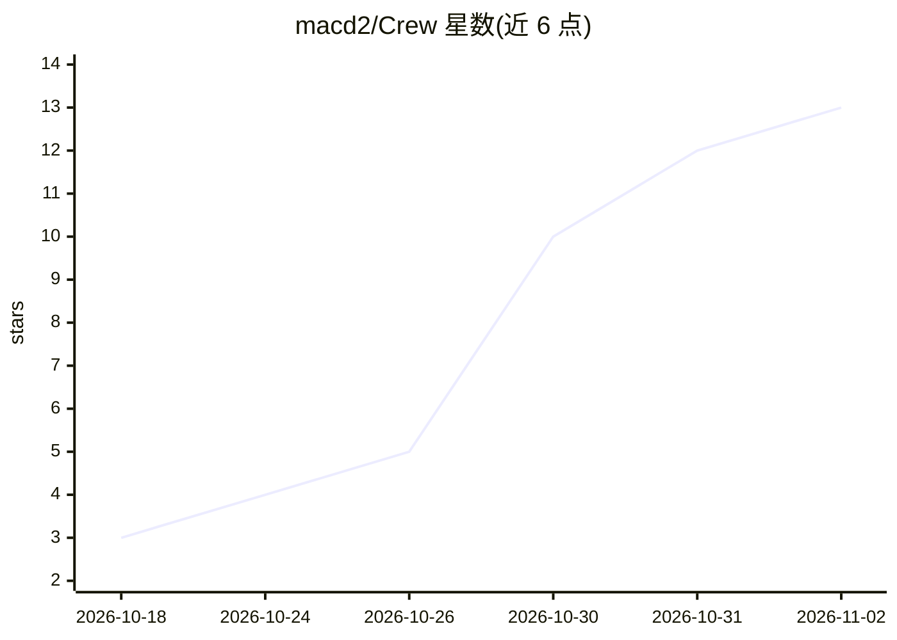

# macd2/Crew

⭐ 13 · Python · Apache-2.0 · 推送 2026-11-01 · [GitHub](https://github.com/macd2/Crew) · [官网](https://crew.forgecoreai.com) · 个人维护

**Hermes 插件：一条 /crew 消息变成看板上经证明完成的工作**

Hermes Agent 的多智能体看板插件：用户发送一条 /crew 消息后，系统生成含目标、产物、完成条件、proof 命令与 token 预算的卡片合同，交给 coordinator 智能体持有至 proof 命令退出 0 才算完成；最多六张卡并行，卡卡带 token 硬预算。安装器创建 coordinator/worker/content/verifier 四个角色 profile（默认模型固定为 Anthropic API），本地仪表盘展示卡片、会话与工具调用。要求 Hermes 0.21.5+ 与 Python 3.11+，Windows 下 proof 在 Git Bash 中运行且无 systemd/cron 相关服务。Apache-2.0，另提供商业支持联系邮箱。

## 筛选速览

| 维度 | 判定 | 备注 |
|---|---|---|
| AI 角色 | `ai-native` | 本体是模型或模型工具 |
| 许可风险 | `permissive` | Apache-2.0 |
| 部署形态 | `desktop` | 安装包/桌面程序 |
| 模型依赖 | — | README 未给出锁定关系 |
| 硬件要求 | — | 无带数字的原话,不猜 |
| 安装摩擦 | `low` | 无编译、无系统依赖或容器化 |
| 成熟度 | — | 结构信号不足 |

## 能力要点

- 卡片合同含 proof 命令与 token 预算，proof 通过才算完成（工具守卫强制）
- coordinator 负责修复、重试、改范围或拆分卡，仅在需要时提问
- 最多六张卡并行，每张卡独立 writer
- 本地仪表盘实时展示卡片、运行、会话、工具调用与判定

## 适用场景

- 对 Hermes Agent 说一句话即让一组 agent 交付并验证工作任务
- 用带 proof 验证的看板替代普通待办流程
- 在自己的 Hermes 实例上自托管运行，无遥测

## 场景标签

`多智能体` · 领域:Agent 开发

## 证据(README 行号)

> L20: **The smart kanban replacement for Hermes Agent.** Hermes
> L119: |**Done means proven**|A card cannot be marked done until its proof command passes - enforced by a tool guard, in 
> L123: |**Self-hosted**|Runs inside your own Hermes, on your own machine. No telemetry.|

## 星数曲线

2026-10-18 3 → 2026-11-02 13（+10）

---
*卡片 v1 · prompt 1.4 · 生成 2026-11-01 · 置信度 high · 依据 README sha `ebc5b3f58b6d` · [字段定义](../../DATASET.md)*
