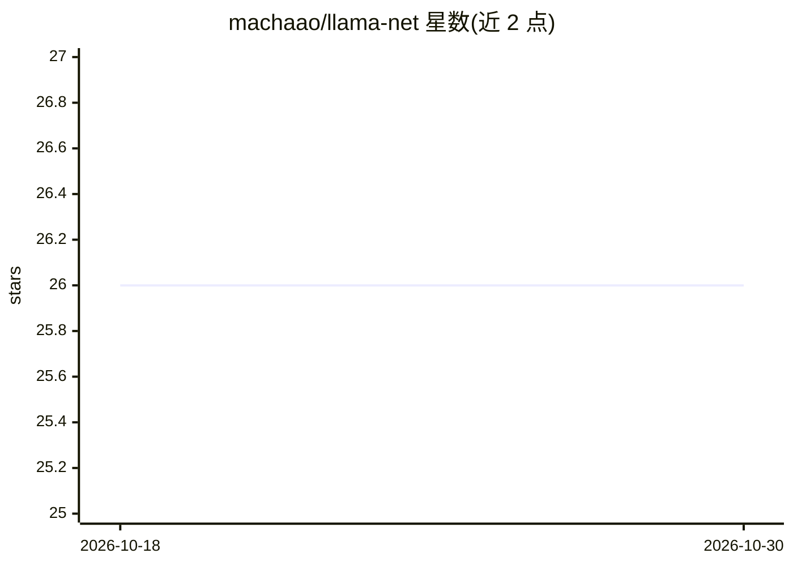

# machaao/llama-net

⭐ 26 · Python · Apache-2.0 · 推送 2026-09-30 · [GitHub](https://github.com/machaao/llama-net) · [官网](https://llamanet.app) · 组织维护

**把 Mac/GPU 变成 OpenAI 兼容推理节点并可共享为公网 API**

基于 llama.cpp 的本地 GGUF LLM 推理服务器：在 Mac Apple Silicon、NVIDIA GPU 或 CPU 上运行 Mistral、Llama 3、Qwen、DeepSeek-R1 等 GGUF 模型，提供 OpenAI 兼容的 /v1/chat/completions 接口，并通过 Cloudflare 隧道在约 60 秒内生成公网 HTTPS URL，节点自动注册到 llamanet.app 网关，由网关做发现、路由与负载均衡。内置 Web UI 支持模型搜索下载、热切换、多模型池（LRU 淘汰）与聊天界面；也可自建私有网关（需 Supabase）。面向希望自建或共享本地推理算力的开发者。

## 筛选速览

| 维度 | 判定 | 备注 |
|---|---|---|
| AI 角色 | `ai-ecosystem` | LLM/agent 周边工具 |
| 许可风险 | `permissive` | Apache-2.0 |
| 部署形态 | `self-host` | docker 或自建部署 |
| 模型依赖 | local-ok | 支持本地模型 |
| 硬件要求 | — | 无带数字的原话,不猜 |
| 安装摩擦 | `low` | 无编译、无系统依赖或容器化 |
| 成熟度 | — | 结构信号不足 |

## 能力要点

- OpenAI 兼容 API（/v1/chat/completions），任何 OpenAI 客户端可直接替换使用
- Cloudflare 隧道自动生成公网 HTTPS URL，零配置共享节点
- 多模型池：LRU 淘汰、按 RAM/VRAM 自动容量检测、模型即时切换
- 可自建私有网关：FastAPI + Supabase，含节点质量门（GPU/延迟/TPS 校验）

## 适用场景

- 把闲置的 Mac 或 NVIDIA GPU 变成 OpenAI 兼容的推理 API 节点
- 通过 Web UI 搜索 Hugging Face、下载并热切换 GGUF 模型
- 团队或组织自建带认证与负载均衡的私有 LLM 网关

## 场景标签

`推理引擎` `模型网关` · 领域:Agent 开发

## 证据(README 行号)

> L14: LlamaNet is a free, open-source local LLM inference server powered by llama.cpp. Run Mistral, Llama 3, Qwen, Phi, G
> L127: - **OpenAI-Compatible API** — Drop-in replacement for any OpenAI client
> L133: - **Gateway Routing** — Central gateway with automatic node discovery and load balancing

## 星数曲线

2026-10-18 26 → 2026-10-30 26（+0）

---
*卡片 v1 · prompt 1.4 · 生成 2026-10-27 · 置信度 mid · 依据 README sha `2bc19be2592d` · [字段定义](../../DATASET.md)*
