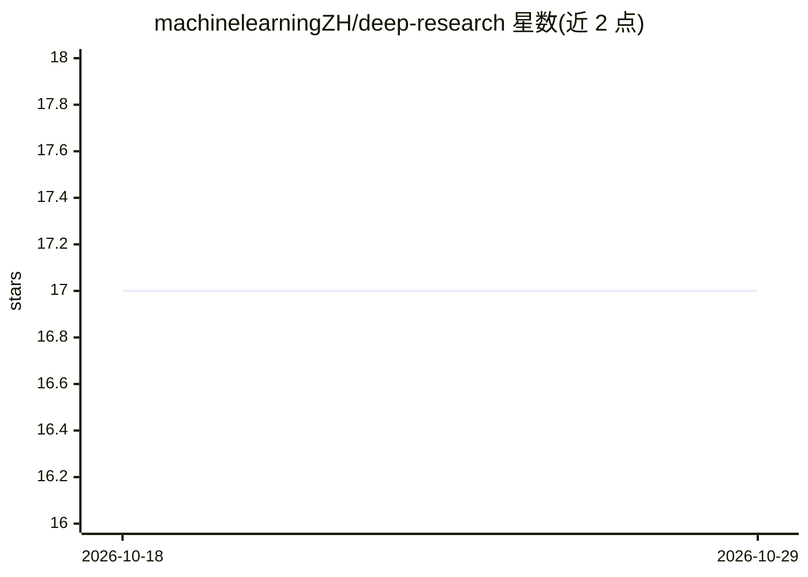

# machinelearningZH/deep-research

⭐ 17 · Python · MIT · 推送 2026-09-10 · [GitHub](https://github.com/machinelearningZH/deep-research) · 组织维护

**对自有文档集合做自动多轮深度研究并生成报告的应用**

苏黎世州统计局团队开发的 Streamlit 应用：在用户自有文档集合上实现 Deep Research 模式。文档切分为 500 token 块，用 multilingual-e5-small 嵌入并索引进 Weaviate Docker 容器，支持混合检索；LLM 调用经 OpenRouter 完成（450+ 模型可选），流程含查询生成、并行相关性检查、全文分析、可选迭代轮次与最终报告生成，可导出 DOCX。代码无 agent 框架，通过编辑配置与源码文件适配自有数据；需自备 OpenRouter API key 与 Docker。

## 筛选速览

| 维度 | 判定 | 备注 |
|---|---|---|
| AI 角色 | `ai-native` | 本体是模型或模型工具 |
| 许可风险 | `permissive` | MIT |
| 部署形态 | `self-host` | docker 或自建部署 |
| 模型依赖 | locked-api |  |
| 硬件要求 | — | 无带数字的原话,不猜 |
| 安装摩擦 | `low` | 无编译、无系统依赖或容器化 |
| 成熟度 | — | 结构信号不足 |

## 能力要点

- 自有文档集合上的多轮迭代深度研究与报告生成
- Weaviate 混合检索 + autocut 去重与相关性并行检查
- 经 OpenRouter 可选 450+ LLM，分层模型配置与并行调用
- 无 agent 框架、从零构建，全流程可定制，支持 DOCX 导出

## 适用场景

- 对内部文档库做限定来源的自动研究并产出报告
- 避免商用 Deep Research 引入外部网络内容污染
- 政府决议、法院判决等结构化文档集的研究分析

## 场景标签

`科研工具` · 领域:学习与行业

## 证据(README 行号)

> L99: This app implements the Deep Research pattern—not on web search, but over your own data collection.\
> L116: - **Final Report Generation:** Synthesize all insight summaries and produce the final report.
> L120: **Chantal Amrhein**, **Patrick Arnecke** – Amt für Statistik und Daten, Team Data

## 星数曲线

2026-10-18 17 → 2026-10-29 17（+0）

---
*卡片 v1 · prompt 1.4 · 生成 2026-10-29 · 置信度 mid · 依据 README sha `4b9f3fd5a2ae` · [字段定义](../../DATASET.md)*
