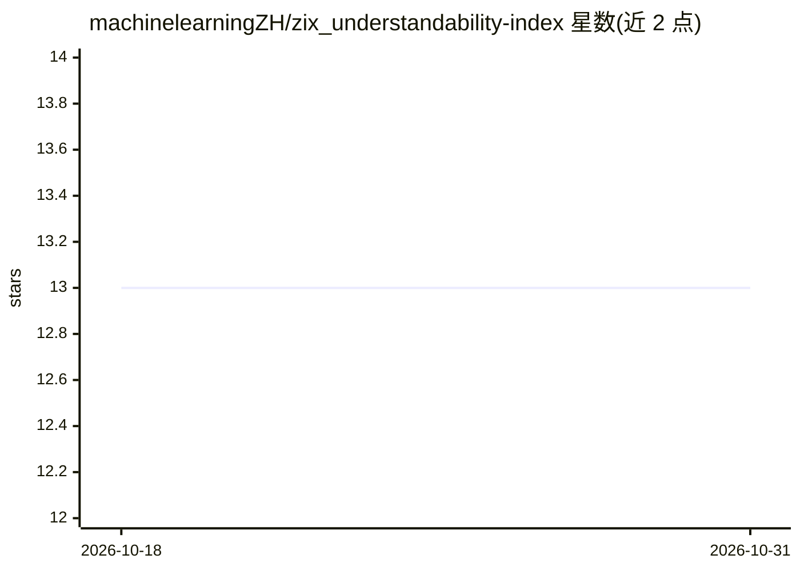

# machinelearningZH/zix_understandability-index

⭐ 13 · Jupyter Notebook · MIT · 推送 2026-10-26 · [GitHub](https://github.com/machinelearningZH/zix_understandability-index) · 组织维护

**测德语文本可理解度的 ZIX 指数包，输出难度分数与 CEFR 级别**

苏黎世统计与数据局团队开发的 Python 库，为德语文本段落提供 ZIX 可理解度分数（-10 到 10，负值对应 B2–C2 难文）与 get_cefr 级别预测。机制：基于 spaCy/textdescriptives 提取 6 个句法与语义特征（句长、简化 RIX、A1/A2/B1 CEFR 词汇覆盖率、常用词分数），用 Ridge 回归预测难度并缩放。训练数据由 10 个 LLM 经 OpenRouter 生成合成样本加行政与法律文本构成。限制：仅适用德语（偏向瑞士德语拼写）、适用段落级文本、非官方 CEFR 测量，未考虑被动语态等 Einfache Sprache 要素。

## 筛选速览

| 维度 | 判定 | 备注 |
|---|---|---|
| AI 角色 | `ai-native` | 本体是模型或模型工具 |
| 许可风险 | `permissive` | MIT |
| 部署形态 | `library` | 以包/库形式分发 |
| 模型依赖 | — | README 未给出锁定关系 |
| 硬件要求 | — | 无带数字的原话,不猜 |
| 安装摩擦 | `low` | 无编译、无系统依赖或容器化 |
| 成熟度 | — | 结构信号不足 |

## 能力要点

- get_zix 输出 -10 到 10 分数，get_cefr 输出 CEFR 级别
- 基于 6 个特征（句长、简化 RIX、CEFR 词汇覆盖率、常用词）的 Ridge 回归模型
- 训练数据含 10 个 LLM 生成的 A1–C2 合成样本与行政/法律文本
- 包内置训练好的模型、缩放器与参考词汇表，spaCy 德语模型自动安装

## 适用场景

- 评估行政或法律德语文本是否需要简化到 B1 及以下
- 对比文本简化前后的可理解度变化
- 为德语文本自动标注 CEFR 难度级别参考

## 场景标签

 · 领域:NLP/文本可理解度评估

## 证据(README 行号)

> L27: ```python
> L105: - Train a Ridge Regressor with cross-validation on the difficulty levels.
> L106: - Scale predicted scores to a -10 to 10 range, centered around 0.

## 星数曲线



2026-10-18 13 → 2026-10-31 13（+0）


---
*卡片 v1 · prompt 1.4 · 生成 2026-10-31 · 置信度 high · 依据 README sha `09647ad2e07e` · [字段定义](../../DATASET.md)*
