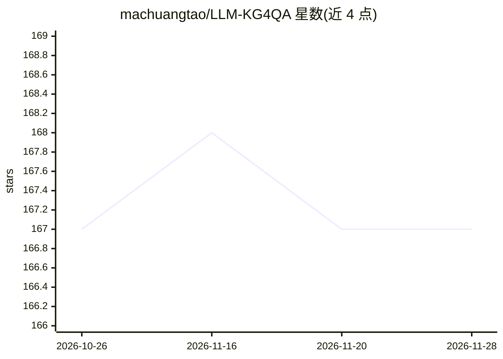

# machuangtao/LLM-KG4QA

⭐ 167 · JavaScript · MIT · 推送 2026-11-23 · [GitHub](https://github.com/machuangtao/LLM-KG4QA) · [官网](https://machuangtao.github.io/LLM-KG4QA/survey-emnlp25) · 组织维护

**LLM+知识图谱问答论文综述清单（EMNLP2025）**

维护 LLM 与知识图谱结合做问答的论文列表，配套发表于 EMNLP2025 主会的综述与 EDBT2025 教程，并提供 BibTeX 引用。条目按 KG 作为背景知识（预训练/微调/KG 增强提示、RAG/Graph RAG/KG RAG）与 KG 作为推理指引（离线/在线/Agent 式）等类别组织，每条含标题、发表venue、年份与论文链接。

## 筛选速览

| 维度 | 判定 | 备注 |
|---|---|---|
| AI 角色 | `ai-knowledge` | 知识聚合/清单类 |
| 许可风险 | `permissive` | MIT |
| 部署形态 | `None` |  |
| 模型依赖 | — | README 未给出锁定关系 |
| 硬件要求 | — | 无带数字的原话,不猜 |
| 安装摩擦 | `low` | 无编译、无系统依赖或容器化 |
| 成熟度 | — | 结构信号不足 |

## 能力要点

- EMNLP2025 主会综述的配套论文清单
- 按 Pre-training/Fine-tuning/KG-Augmented Prompting/RAG/Graph RAG/KG RAG 等类别组织条目
- 提供 BibTeX 引用条目
- 含 EDBT2025 教程

## 适用场景

- 查找 LLM+KG 问答方向的相关论文
- 按技术路线（如 Graph RAG、KG 增强微调）浏览研究工作
- 撰写综述或调研时引用该论文

## 场景标签

`精选清单` · 领域:学习与行业

## 证据(README 行号)

> L9: - **`2024-12`** We create this repository to maintain a paper list on **LLMs and KGs for QA.**
> L24: ## 1. LLMs and KGs for QA

## 星数曲线

2026-10-26 167 → 2026-11-28 167（+0）

---
*卡片 v1 · prompt 1.4 · 生成 2026-11-27 · 置信度 high · 依据 README sha `54b66b7e1e14` · [字段定义](../../DATASET.md)*
