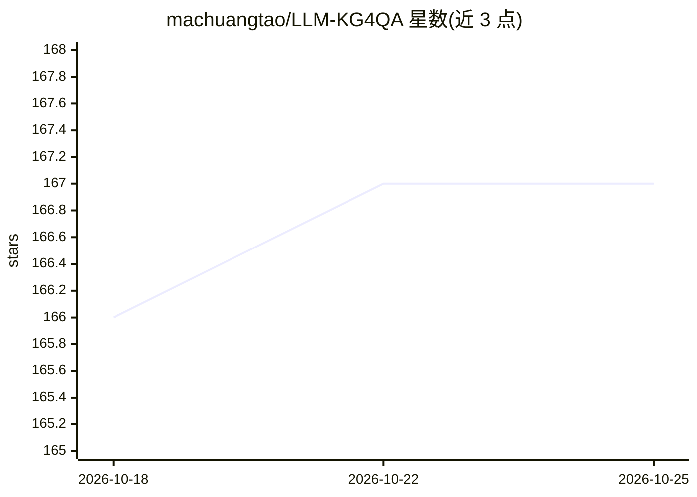

# machuangtao/LLM-KG4QA

⭐ 167 · JavaScript · MIT · 推送 2025-11-24 · [GitHub](https://github.com/machuangtao/LLM-KG4QA) · [官网](https://machuangtao.github.io/LLM-KG4QA/survey-emnlp25) · 组织维护

**LLM+知识图谱问答方向的论文综述清单（EMNLP2025）**

EMNLP2025 主会综述《Large Language Models Meet Knowledge Graphs for Question Answering》的配套论文清单仓库，2024年12月创建。按'KG作为背景知识'与'KG作为推理引导'两大主线组织条目，细分为预训练/微调、KG增强提示、RAG/Graph RAG/KG RAG、离线与在线KG引导、Agent-based引导、协同推理等类别，每条含会议、年份、分类与论文链接。提供 BibTeX 引用条目，无代码或安装步骤。

## 筛选速览

| 维度 | 判定 | 备注 |
|---|---|---|
| AI 角色 | `ai-knowledge` | 知识聚合/清单类 |
| 许可风险 | `permissive` | MIT |
| 部署形态 | `None` |  |
| 模型依赖 | — | README 未给出锁定关系 |
| 硬件要求 | — | 无带数字的原话,不猜 |
| 安装摩擦 | `low` | 无编译、无系统依赖或容器化 |
| 成熟度 | — | 结构信号不足 |

## 能力要点

- 按 KG 背景知识与 KG 推理引导两大主线组织论文
- 覆盖 RAG/Graph RAG/KG RAG 等细分方向的论文条目
- 条目含会议、年份、分类与论文链接
- 提供综述论文的 BibTeX 引用

## 适用场景

- 查找 LLM+KG 问答方向已发表工作的论文列表
- 按 RAG、Graph RAG 等类别检索相关论文
- 跟进该方向 2022-2025 年的会议发表情况

## 场景标签

`精选清单` · 领域:学习与行业

## 证据(README 行号)

> L6: - **`2025-08`** Our survey has been accepted to **EMNLP2025** main conference.
> L9: - **`2024-12`** We create this repository to maintain a paper list on **LLMs and KGs for QA.**
> L24: ## 1. LLMs and KGs for QA

## 星数曲线

2026-10-18 166 → 2026-10-25 167（+1）

---
*卡片 v1 · prompt 1.4 · 生成 2026-10-22 · 置信度 high · 依据 README sha `dc6d5e333f40` · [字段定义](../../DATASET.md)*
