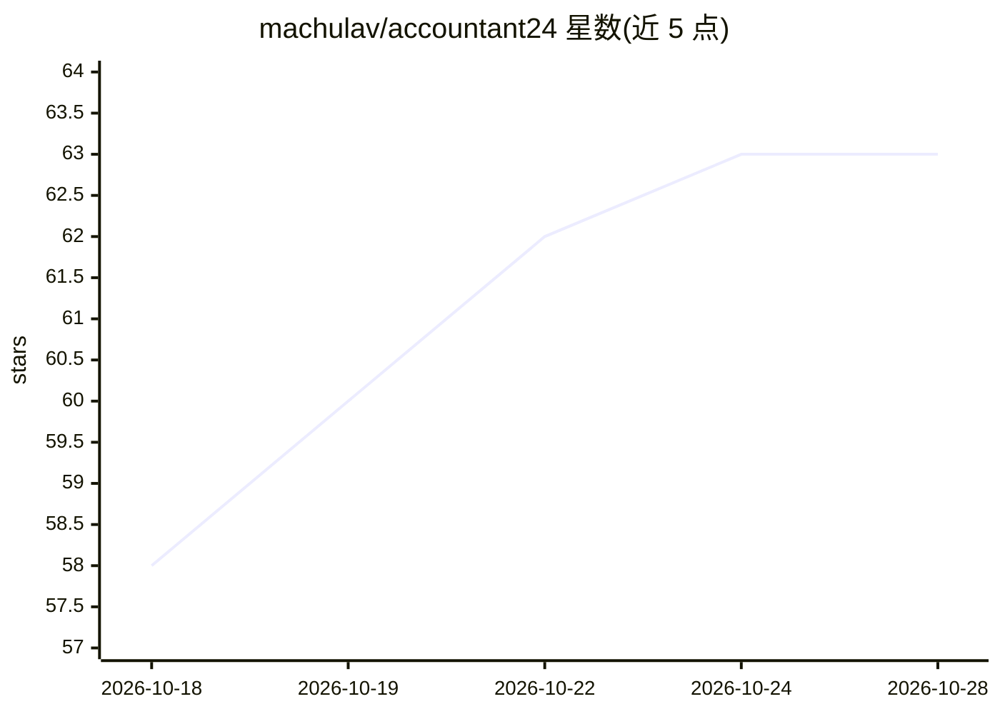

# machulav/accountant24

⭐ 63 · TypeScript · Apache-2.0 · 推送 2026-09-25 · [GitHub](https://github.com/machulav/accountant24) · [官网](https://accountant24.ai) · 个人维护

**本地优先的个人记账 AI agent：自然语言记账、对账、查账**

面向个人用户的桌面记账应用：以自然语言记录支出、导入 PDF 银行流水与收据照片、用对话查询消费与净资产，并可通过指令教 agent 记住规则（如预算提醒、旅行标签）。底层用 hledger 做复式记账、git 自动版本化所有变更，支持插件市场安装技能（skill）。数据以纯文本形式保存在本机，可接入任意 LLM 供应商，包括通过 Ollama 完全本地运行。目前提供 macOS（Apple Silicon）下载。

## 筛选速览

| 维度 | 判定 | 备注 |
|---|---|---|
| AI 角色 | `ai-native` | 本体是模型或模型工具 |
| 许可风险 | `permissive` | Apache-2.0 |
| 部署形态 | `None` |  |
| 模型依赖 | local-ok | 支持本地模型 |
| 硬件要求 | — | 无带数字的原话,不猜 |
| 安装摩擦 | `low` | 无编译、无系统依赖或容器化 |
| 成熟度 | — | 结构信号不足 |

## 能力要点

- 自然语言输入自动生成 hledger 复式记账条目
- 导入 PDF 银行流水/发票/收据照片并提取交易，原文件归档
- 所有变更自动提交到本地 git 仓库，可回滚
- 插件市场安装技能，支持 Ollama 完全本地运行

## 适用场景

- 用日常对话记录和管理个人收支，代替手工记账
- 导入银行流水和收据自动补全账目
- 询问消费情况、净资产并设置预算提醒

## 场景标签

 · 领域:个人财务/记账

## 证据(README 行号)

> L1: # Accountant24 - Open source AI agent for personal finance
> L3: Track spending in plain language, import bank statements and receipts, ask questions about your money. Your data sta
> L15: The agent figures out the details and adds it to your ledger as a proper double-entry transaction.

## 星数曲线

2026-10-18 58 → 2026-10-28 63（+5）

---
*卡片 v1 · prompt 1.4 · 生成 2026-10-24 · 置信度 high · 依据 README sha `99774c25e5ce` · [字段定义](../../DATASET.md)*
