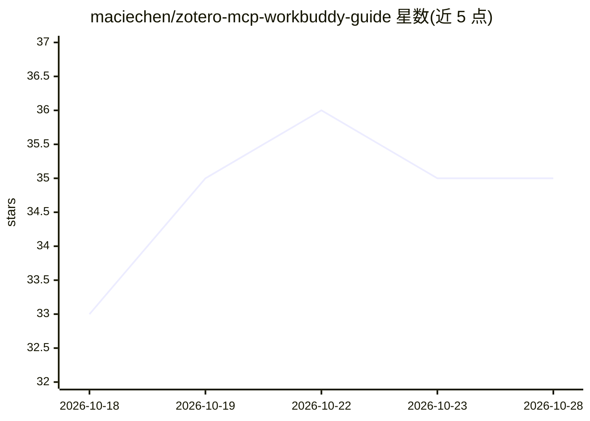

# maciechen/zotero-mcp-workbuddy-guide

⭐ 35 · Python · NOASSERTION · 推送 2026-05-29 · [GitHub](https://github.com/maciechen/zotero-mcp-workbuddy-guide) · 个人维护 · 中文 README

**将 Zotero 文献库接入 WorkBuddy 的中文配置指南**

面向 WorkBuddy 用户的配置指南仓库，基于上游项目 54yyyu/zotero-mcp（v0.4.1），指导将 Zotero 文献库通过 MCP 接入，实现自然语言文献搜索、PDF 批注整理、引文管理与文献综述草稿。提供本地/云端/混合三种模式文档与 JSON 配置模板，并设计为 AI 可自主执行：AI 读取 AI_BOOTSTRAP.md 后自动检查环境、安装依赖、写入配置。本地模式支持 PDF 全文检索与完整批注提取，云端模式支持完整写权限，语义搜索为可选扩展。

## 筛选速览

| 维度 | 判定 | 备注 |
|---|---|---|
| AI 角色 | `ai-knowledge` | 知识聚合/清单类 |
| 许可风险 | `none` | NOASSERTION |
| 部署形态 | `None` |  |
| 模型依赖 | — | README 未给出锁定关系 |
| 硬件要求 | — | 无带数字的原话,不猜 |
| 安装摩擦 | `low` | 无编译、无系统依赖或容器化 |
| 成熟度 | — | 结构信号不足 |

## 能力要点

- 本地/云端/混合三种接入模式的配置文档与对比表
- AI 自主配置流程（AI_BOOTSTRAP.md 启动入口，含 EXEC/CHECK/ASK 标记约定）
- configs/ 目录提供纯 JSON 配置模板
- 可选扩展：语义搜索与 Scite 引用智能

## 适用场景

- 在 WorkBuddy 中用自然语言检索和管理 Zotero 文献
- 让 AI 自动完成 Zotero MCP 的接入配置
- 按远程或桌面场景选择云端/本地接入模式

## 场景标签

`科研工具` `教程课程` · 领域:学习与行业

## 证据(README 行号)

> L8: 将 Zotero 文献库接入 WorkBuddy，用自然语言对话完成文献搜索、批注整理、引文管理、文献综述草稿等任务。本仓库提供**完整的中文配置指南**，支持本地模式和云端模式，且设计为 **AI 可自主执行**——你只需一句话，
> L51: ├── AI_BOOTSTRAP.md        ← AI 自动配置的启动入口

## 星数曲线

2026-10-18 33 → 2026-10-28 35（+2）

---
*卡片 v1 · prompt 1.4 · 生成 2026-10-25 · 置信度 high · 依据 README sha `754b82fcbe24` · [字段定义](../../DATASET.md)*
