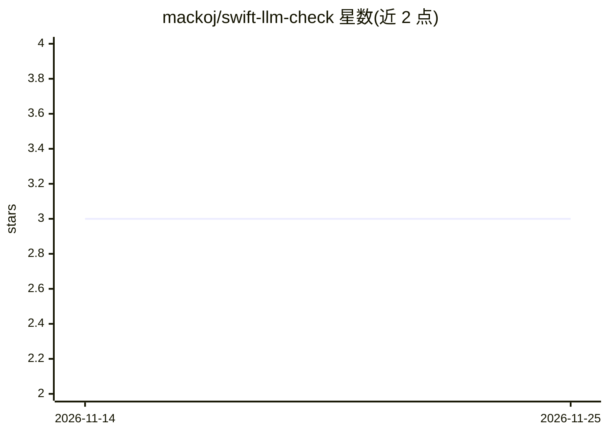

# mackoj/swift-llm-check

⭐ — · [GitHub]() · 个人维护

**给 Swift 开发者：以测试形式编写的架构与 lint 规则库**

以 Swift Testing 测试形式承载的架构与 lint 规则库，供 Swift 代码库在 CI 中运行。违规以单条 issue 记录在违规文件、行与列，附规则全文（标题、理由、修复方式及正反示例），使读者无需询问即可修复；README 明确该读者常为 AI agent。提供 Codebase 文件扫描、声明查询、文本节点搜索等 API，支持基线（baseline）与 AGENTS.md/SKILL.md 规则目录生成。要求 Swift 6 与 macOS 14/iOS 17，唯一依赖为 swift-syntax。

## 筛选速览

| 维度 | 判定 | 备注 |
|---|---|---|
| AI 角色 | `ai-enhanced` | 去掉 AI 部分产品仍成立 |
| 许可风险 | `permissive` | — |
| 部署形态 | `None` |  |
| 模型依赖 | — | README 未给出锁定关系 |
| 硬件要求 | — | 无带数字的原话,不猜 |
| 安装摩擦 | `low` | 无编译、无系统依赖或容器化 |
| 成熟度 | — | 结构信号不足 |

## 能力要点

- 违规 issue 附规则理由、修复方式与正反示例，供人或 AI agent 自主修复
- RuleCatalog 可将规则渲染为 Markdown，供 AGENTS.md 或 SKILL.md 使用
- 基线机制：不再匹配任何发现的条目会作为过期而失败
- 文件读取与语法解析按进程缓存，多套件并行读取安全

## 适用场景

- 在 CI 中对 Swift 代码库执行团队自定架构规则
- 让 AI agent 依据规则目录自主修复违规代码
- 以基线方式让新规则先落地、再逐步收敛存量违规

## 场景标签

`代码审查` · 领域:编码与开发

## 证据(README 行号)

> L9: Architecture and lint rules for Swift codebases, written as Swift Testing tests. A failing rule records one issue pe
> L12: That reader is often an AI agent.
> L216: `RuleCatalog` renders rules as Markdown, one section per category, for an `AGENTS.md` section or a `SKILL.md`.

## 星数曲线

2026-11-14 3 → 2026-11-25 3（+0）

---
*卡片 v1 · prompt 1.4 · 生成 2026-11-21 · 置信度 mid · 依据 README sha `3f650d5f945b` · [字段定义](../../DATASET.md)*
