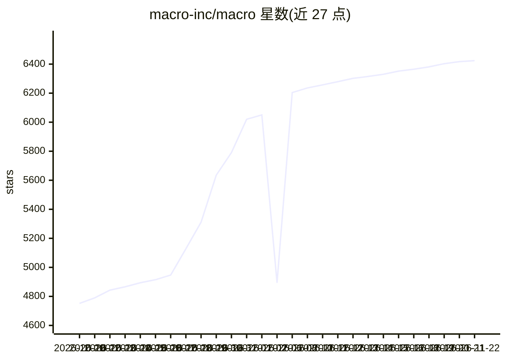

# macro-inc/macro

⭐ 6,424 · Rust · AGPL-3.0 · 推送 2026-11-21 · [GitHub](https://github.com/macro-inc/macro) · [官网](https://macro.com) · 组织维护

**团队一体化工作区：邮件/聊天/文档/任务/CRM 与 agent 共享记忆**

面向团队的统一工作平台，将邮件、消息、文档、任务、通话、agents、CRM 与数据库合并到单一界面，所有条目通过 @链接存储为双向图，共享团队级记忆。文档基于 CRDT 实时协作，支持离线编辑与版本分叉；任务可与来源邮件、agent 会话、PR 双向链接；agents 可编辑文档、查询数据库、起草邮件，通过 MCP/API/SDK 接入。由公司以 SaaS 形式提供，含 iOS/Android/Web 客户端，未提供自行部署途径。

## 筛选速览

| 维度 | 判定 | 备注 |
|---|---|---|
| AI 角色 | `ai-enhanced` | 去掉 AI 部分产品仍成立 |
| 许可风险 | `viral` | AGPL-3.0 |
| 部署形态 | `None` |  |
| 模型依赖 | — | README 未给出锁定关系 |
| 硬件要求 | — | 无带数字的原话,不猜 |
| 安装摩擦 | `low` | 无编译、无系统依赖或容器化 |
| 成熟度 | — | 结构信号不足 |

## 能力要点

- 邮件、聊天、文档、任务、CRM、数据库等模块 @链接成双向图
- agents 作为一等公民可编辑 CRDT 文档、执行任务并更新状态
- 暴露统一搜索的 tools/MCP 接口，agent 可直接检索邮件附件 PDF
- 支持 WhatsApp 会话接入与外部人员加入聊天

## 适用场景

- 把团队邮件、聊天、任务和文档从多个工具迁到一个系统
- 让 agent 依据任务上下文自动完成工作并更新状态
- 以邮件聚合方式管理公司与联系人记录（CRM）
- 用自建数据库管理招聘、客户请求等内容

## 场景标签

`知识库管理` `AI 助手` `工作流自动化` · 领域:效率与自动化

## 证据(README 行号)

> L23: Macro is the all-in-one workspace for you and your team. It unifies email + messages + docs + tasks + calls + agent
> L46: |Agents|Docs &rarr;|Use our models or your agents to work across Macro and automate tasks.|

## 星数曲线

2026-10-20 4,752 → 2026-11-22 6,424（+1,672）

---
*卡片 v1 · prompt 1.4 · 生成 2026-11-22 · 置信度 high · 依据 README sha `d198f830ce88` · [字段定义](../../DATASET.md)*
