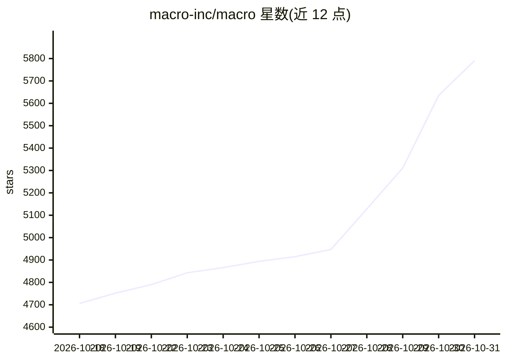

# macro-inc/macro

⭐ 5,791 · Rust · AGPL-3.0 · 推送 2026-10-30 · [GitHub](https://github.com/macro-inc/macro) · [官网](https://macro.com) · 组织维护

**团队一体化工作区：邮件/聊天/文档/任务/CRM 与共享 AI 记忆**

面向小团队和大型公司内团队的统一工作区，将邮件、消息、文档、任务、Agent、通话与 CRM 合并到单一界面，元素间以双向图 @link 互联并支持搜索。AI 部分：可代为执行操作的 Agent、团队级共享记忆（由 cron 从对话、邮件、任务等合成更新）、通话转录入记忆、Agent 经 MCP/API 参与文档协作。采用 SolidJS 与 Rust 构建，提供网页端与 iOS 应用。

## 筛选速览

| 维度 | 判定 | 备注 |
|---|---|---|
| AI 角色 | `ai-enhanced` | 去掉 AI 部分产品仍成立 |
| 许可风险 | `viral` | AGPL-3.0 |
| 部署形态 | `None` |  |
| 模型依赖 | — | README 未给出锁定关系 |
| 硬件要求 | — | 无带数字的原话,不猜 |
| 安装摩擦 | `low` | 无编译、无系统依赖或容器化 |
| 成熟度 | — | 结构信号不足 |

## 能力要点

- 邮件/消息/任务/文档/CRM 等以双向图 @link 互联
- Agent 可代为操作，作为一等公民参与频道与 CRDT 文档协作
- 团队级记忆由定时任务从对话、邮件、任务综合生成
- 支持 MCP、API、SDK 外部接入

## 适用场景

- 小团队用单一系统替代 Slack/Linear/Notion/HubSpot 等分散工具
- 让 Agent 基于团队全部上下文协助检索、起草邮件与更新 CRM
- 从客户邮件一键创建关联任务并全程溯源

## 场景标签

`知识库管理` `AI 助手` `Agent 记忆` · 领域:Agent 开发

## 证据(README 行号)

> L19: Macro is the all-in-one workspace for you and your team. It unifies email + messages + docs + tasks + agents + CRM 
> L42: |Agents|Docs &rarr;|Unified, team-level memory. Can take action on your behalf.|
> L131: Since Macro has the team context in a single database, it is uniquely positioned to offer team-level memory with f

## 星数曲线

2026-10-18 4,706 → 2026-10-31 5,791（+1,085）

---
*卡片 v1 · prompt 1.4 · 生成 2026-10-20 · 置信度 high · 依据 README sha `e71250e41826` · [字段定义](../../DATASET.md)*
