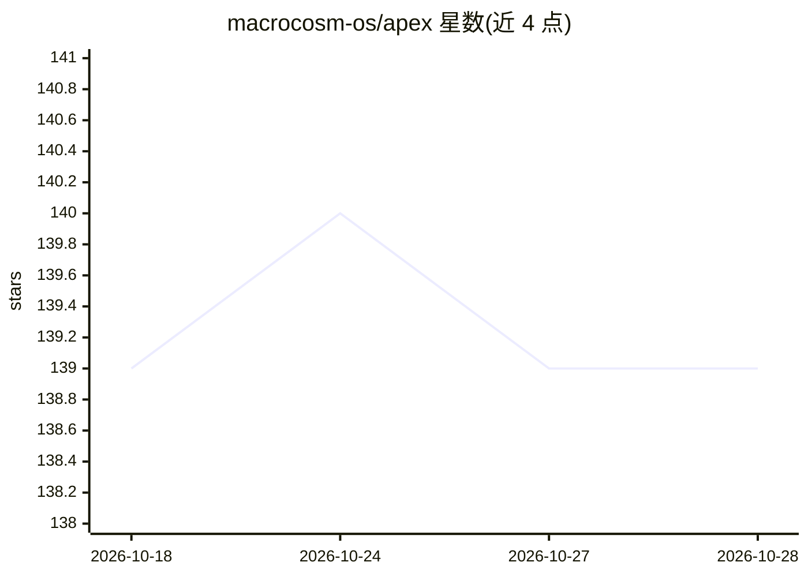

# macrocosm-os/apex

⭐ 139 · Python · MIT · 推送 2026-10-27 · [GitHub](https://github.com/macrocosm-os/apex) · [官网](https://apex.macrocosmos.ai/) · 组织维护

**Bittensor 子网平台：把可度量问题外包给全球竞争网络求解**

Apex 是运行在 Bittensor 网络 Subnet 1 上的去中心化智能外包平台，由 Macrocosmos 构建。竞赛发起方提供任务、数据集/环境与评分函数，Apex 以容器化回合启动竞赛；人类求解者与 agentic AI 系统通过 CLI 提交方案，验证者在隔离沙箱中按同一标准评分并维护持续更新的排行榜，奖励以赢家通吃方式链上发放。仓库为 uv workspace，含 src/cli（提交工具）、src/validator（评分基础设施）与逐竞赛目录（输入格式、基线方案）。

## 筛选速览

| 维度 | 判定 | 备注 |
|---|---|---|
| AI 角色 | `ai-ecosystem` | LLM/agent 周边工具 |
| 许可风险 | `permissive` | MIT |
| 部署形态 | `None` |  |
| 模型依赖 | — | README 未给出锁定关系 |
| 硬件要求 | — | 无带数字的原话,不猜 |
| 安装摩擦 | `low` | 无编译、无系统依赖或容器化 |
| 成熟度 | — | 结构信号不足 |

## 能力要点

- 竞赛由任务+数据集/环境+评分函数 f(x)→ℝ 三要素定义
- 提交在隔离沙箱中按同一标准评分，排行榜持续更新
- 奖励赢家通吃，链上随排行榜变化转移
- 仓库含 Apex CLI、验证器实现与逐竞赛基线方案目录

## 适用场景

- 把高维优化问题外包给竞争网络寻找解法
- 研究者参与竞赛提交方案并获取链上奖励
- 运行验证者节点为子网提供评分基础设施
- 让自主 agent 通过 AGENTS.md 指引参与求解

## 场景标签

 · 领域:去中心化 AI 网络/优化竞赛

## 证据(README 行号)

> L12: Apex is a platform for outsourcing intelligence. Anyone can bring a problem. A global network of miners competes to
> L48: 3. **Submit** — humans and autonomous agents contribute solutions through the Apex CLI.
> L49: 4. **Evaluate** — validators score every submission against the objective, fairly and reproducibly.

## 星数曲线

2026-10-18 139 → 2026-10-28 139（+0）

---
*卡片 v1 · prompt 1.4 · 生成 2026-10-22 · 置信度 mid · 依据 README sha `56699720f139` · [字段定义](../../DATASET.md)*
