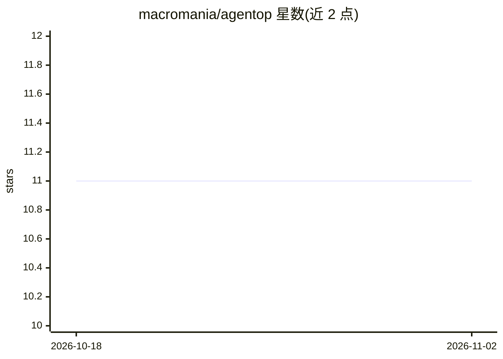

# macromania/agentop

⭐ 11 · TypeScript · MIT · 推送 2026-04-01 · [GitHub](https://github.com/macromania/agentop) · 个人维护

**目标优先的并行 agent 桌面应用：AI 规划拆解任务并多代理并行执行**

Electron 桌面应用（Bun + React），以目标（goal）而非对话驱动 AI 工作流：用户用自然语言定义目标，LLM 规划器自动分解为结构化任务层级，多个 Copilot 驱动的 agent 会话并行执行独立任务。提供双层界面（树视图 + 画布式 DAG 思维导图）与基于注意力的委派系统（supervised/delegated/sensitive 三种模式，破坏性操作需人工批准）。支持 SKILL.md 技能文件、MCP 服务器配置（内置 12 个目录）。作者声明为个人实验项目，处于早期阶段，预期有粗糙边缘与破坏性变更。

## 筛选速览

| 维度 | 判定 | 备注 |
|---|---|---|
| AI 角色 | `ai-native` | 本体是模型或模型工具 |
| 许可风险 | `permissive` | MIT |
| 部署形态 | `desktop` | 安装包/桌面程序 |
| 模型依赖 | — | README 未给出锁定关系 |
| 硬件要求 | — | 无带数字的原话,不猜 |
| 安装摩擦 | `low` | 无编译、无系统依赖或容器化 |
| 成熟度 | `idea` | |

## 能力要点

- LLM 规划器将自然语言目标分解为可并行/串行执行的任务层级
- 多 agent 会话并行执行，含流式步骤、中止/暂停/恢复与重试
- 三种委派模式，破坏性操作强制人工批准
- SKILL.md 技能文件与 MCP 服务器配置（stdio/HTTP/SSE，内置 12 个）

## 适用场景

- 把高层次目标交给 AI 拆解并由多代理并行完成
- 在画布 DAG 中查看每个 agent 的思考、工具调用与输出
- 通过敏感操作审批机制保持对 agent 的控制

## 场景标签

`多智能体` `AI 助手` · 领域:Agent 开发

## 证据(README 行号)

> L3: AgentOp is an outcome-focused parallel agent desktop application that replaces chat-driven AI workflows with a goal-
> L25: - **Parallel agent execution** — Multiple Copilot-powered agent sessions run simultaneously on independent tasks un
> L24: - **Goal-first workflow** — Create goals with natural language prompts; an LLM planner automatically decomposes the

## 星数曲线

2026-10-18 11 → 2026-11-02 11（+0）

---
*卡片 v1 · prompt 1.4 · 生成 2026-11-02 · 置信度 high · 依据 README sha `a54a7feedd39` · [字段定义](../../DATASET.md)*
