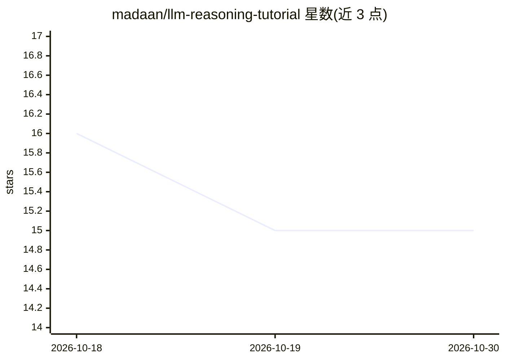

# madaan/llm-reasoning-tutorial

⭐ 15 · Jupyter Notebook · Apache-2.0 · 推送 2026-04-02 · [GitHub](https://github.com/madaan/llm-reasoning-tutorial) · 个人维护

**面向研究者的 LLM 推理与提示技术教程（笔记本合集）**

配套 BHI 2023 与 ACL 2023 教程的资源仓库，核心是一组可交互 Jupyter 笔记本：从梯度下降、注意力到 Transformer 的基础构建（本地 PyTorch 运行、无需 API key）、GPT-2 语言模型概述、少样本/零样本提示基础，以及提示关键技巧（直接提示与思维链、memory 辅助提示、输出解析评估）。提示实验部分需 OpenAI 兼容 API（OpenAI 或 xAI Grok），通过环境变量配置密钥并调整 BASE_URL 与 DEFAULT_MODEL。另附作者博客等延伸资源。

## 筛选速览

| 维度 | 判定 | 备注 |
|---|---|---|
| AI 角色 | `ai-knowledge` | 知识聚合/清单类 |
| 许可风险 | `permissive` | Apache-2.0 |
| 部署形态 | `None` |  |
| 模型依赖 | — | README 未给出锁定关系 |
| 硬件要求 | — | 无带数字的原话,不猜 |
| 安装摩擦 | `low` | 无编译、无系统依赖或容器化 |
| 成熟度 | — | 结构信号不足 |

## 能力要点

- 从 SGD 到 Transformer 的本地交互式基础笔记本（PyTorch，无需 API key）
- 少样本/零样本提示与思维链、memory 辅助提示的工作流演示
- 支持 OpenAI 与 xAI Grok 等 OpenAI 兼容 API 作为实验后端

## 适用场景

- 系统学习 LLM 提示与推理技术的关键方法
- 在教学或自学中运行交互式笔记本动手实验
- 比较 temperature、stop tokens 等参数对模型输出的影响

## 场景标签

`教程课程` `提示工程` · 领域:Agent 开发

## 证据(README 行号)

> L7: - BHI 2023 Tutorial (Oct 2023)
> L19: ## Notebooks

## 星数曲线

2026-10-18 16 → 2026-10-30 15（-1）

---
*卡片 v1 · prompt 1.4 · 生成 2026-10-30 · 置信度 high · 依据 README sha `d14436115560` · [字段定义](../../DATASET.md)*
