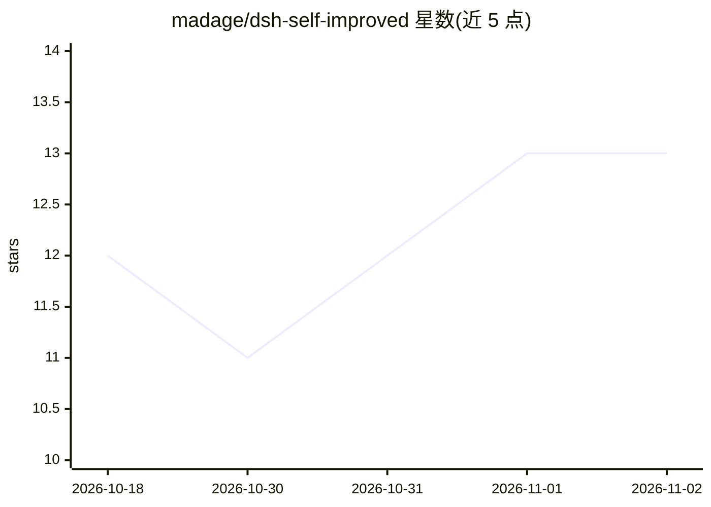

# madage/dsh-self-improved

⭐ 13 · TypeScript · MIT · 推送 2026-08-15 · [GitHub](https://github.com/madage/dsh-self-improved) · [官网](https://github.com/madage/dsh-self-improved) · 个人维护 · 中文 README

**DeepSeek Harness 的本地长期记忆与自进化插件**

面向 DeepSeek Harness（DSH）的插件，为其补充分会话记忆与自我演化两项能力：从对话中自动提炼事实/偏好/事件/指令存入本地 SQLite（FTS5 + sqlite-vec），每轮对话前注入相关记忆；记忆经巩固、衰减与纠错，成功工作流可蒸馏为可复用技能，并持续演化用户画像。架构参考 TencentDB Agent Memory 四层金字塔（L0 采集→L1 提取→L2 场景→L3 画像），但为独立实现，复用 DSH 原生服务，数据完全本地不上传。通过 dsh plugin add / 插件市场一键安装。

## 筛选速览

| 维度 | 判定 | 备注 |
|---|---|---|
| AI 角色 | `ai-ecosystem` | LLM/agent 周边工具 |
| 许可风险 | `permissive` | MIT |
| 部署形态 | `None` |  |
| 模型依赖 | locked-api |  |
| 硬件要求 | — | 无带数字的原话,不猜 |
| 安装摩擦 | `low` | 无编译、无系统依赖或容器化 |
| 成熟度 | — | 结构信号不足 |

## 能力要点

- 四层记忆金字塔：L0 采集→L1 提取→L2 场景→L3 用户画像
- 记忆自动注入 + 巩固/衰减/纠错 + 技能蒸馏
- 完全本地 SQLite 存储（FTS5 + sqlite-vec），不上传数据
- /memory 命令零 LLM 调用，15 分钟维护循环与每夜演化调度

## 适用场景

- 让 DSH 助手跨会话记住我的偏好、事实与指令
- 把成功工作流蒸馏为可复用技能
- 在设置界面查看/过滤/修正/遗忘记忆与画像

## 场景标签

`Agent 记忆` · 领域:Agent 开发

## 证据(README 行号)

> L9: Adds the two missing capabilities to DSH — "cross-session memory + self-evolution":
> L14: The architecture follows the four-layer memory pyramid of TencentDB Agent Memory (L0 capture → L1 extraction → L2 s

## 星数曲线

2026-10-18 12 → 2026-11-02 13（+1）

---
*卡片 v1 · prompt 1.4 · 生成 2026-10-31 · 置信度 high · 依据 README sha `03b706e11489` · [字段定义](../../DATASET.md)*
