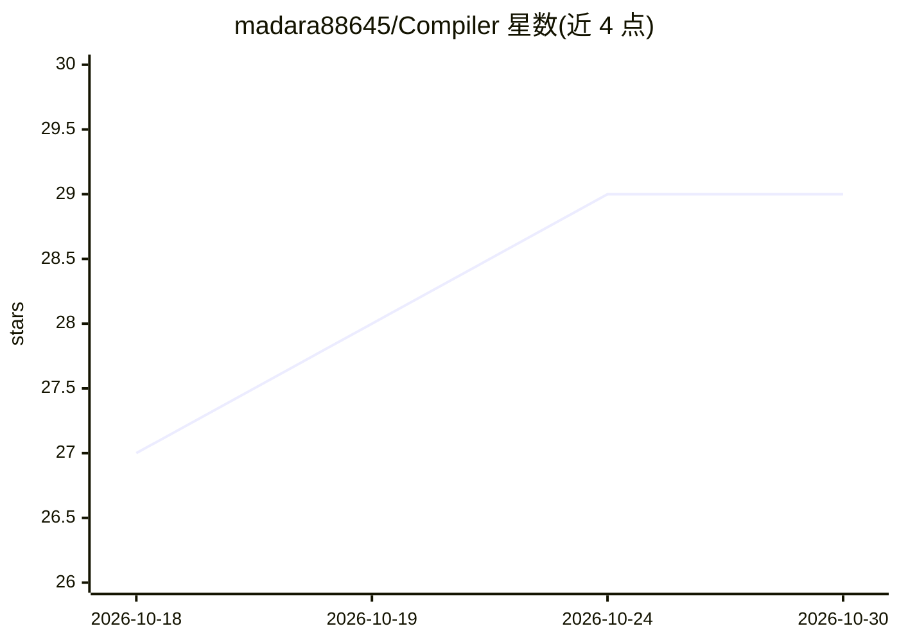

# madara88645/Compiler

⭐ 29 · Python · Apache-2.0 · 推送 2026-10-29 · [GitHub](https://github.com/madara88645/Compiler) · [官网](https://prcompiler.com/) · 个人维护

**离线提示词编译器：模糊请求→结构化提示词/执行计划/策略与 PR 合并检查**

面向开发者的提示词工程与工作流工具：将模糊请求编译为 System/User Prompt、执行计划、扩展提示词、策略层（风险级别/允许工具/数据敏感度）与就绪红绿灯检查；附带 PR Safety 层，粘贴 AI-agent PR 即给出 merge/hold/split/rebase 裁决与信号报告。核心管线离线确定性运行、无需 API key，由 1,700+ 测试锁定；云端功能可选经 OpenRouter。另含 Agent/Skill 生成器、Claude Agent Packs（beta）与 MCP 工具导出。限制：Agent Packs 处于 beta，生成物需人工审查。

## 筛选速览

| 维度 | 判定 | 备注 |
|---|---|---|
| AI 角色 | `ai-ecosystem` | LLM/agent 周边工具 |
| 许可风险 | `permissive` | Apache-2.0 |
| 部署形态 | `desktop` | 安装包/桌面程序 |
| 模型依赖 | — | README 未给出锁定关系 |
| 硬件要求 | — | 无带数字的原话,不猜 |
| 安装摩擦 | `low` | 无编译、无系统依赖或容器化 |
| 成熟度 | `idea` | |

## 能力要点

- 离线确定性编译管线，无需 API key 与网络
- PR Safety 给出 merge/hold/split/rebase 合并就绪裁决
- 按步骤调度探索模式（explore/decide/execute/verify）
- Agent/Skill 生成器可导出 Claude SDK、LangChain、FastMCP 代码

## 适用场景

- 把模糊需求整理成可直接粘贴 LLM 的结构化提示词
- 合并 AI-agent PR 前获取确定性的合并就绪评估
- 快速生成 Claude Code 项目约定与 MCP 工具脚手架

## 场景标签

`提示工程` `代码生成` `代码审查` · 领域:Agent 开发

## 证据(README 行号)

> L8: **Prompt Compiler** turns vague requests into structured prompts, execution plans, and policy-checked workflows — so
> L20: **Compile a request.** Type any request — a feature idea, a bug report, a research question — and Prompt Compiler p
> L29: The core pipeline is **offline and deterministic** — compilation needs no API key and no network — and is locked in

## 星数曲线

2026-10-18 27 → 2026-10-30 29（+2）

---
*卡片 v1 · prompt 1.4 · 生成 2026-10-26 · 置信度 high · 依据 README sha `620bd0d34427` · [字段定义](../../DATASET.md)*
