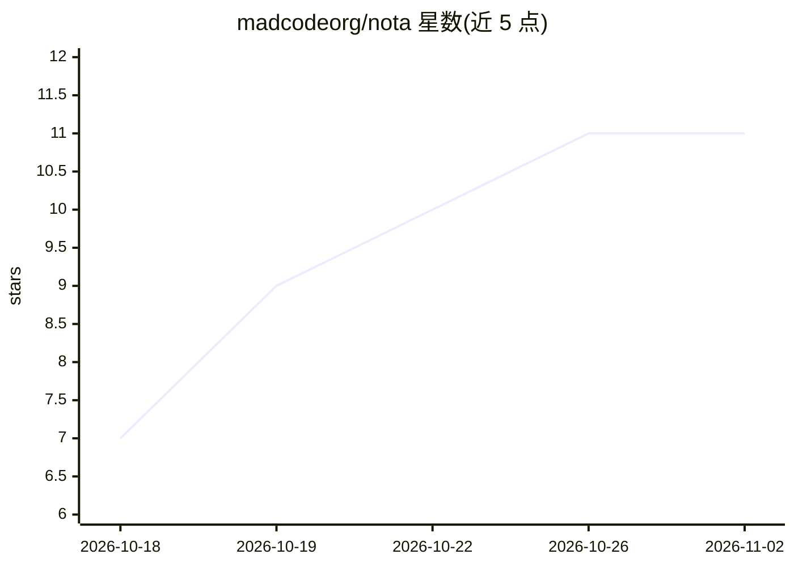

# madcodeorg/nota

⭐ 11 · TypeScript · MIT · 推送 2026-11-01 · [GitHub](https://github.com/madcodeorg/nota) · [官网](https://thenota.app) · 组织维护

**本地优先的笔记/白板/会议转写桌面工作区**

Nota 是基于 Electron 的本地优先桌面应用，整合文档、白板、会议记录与 AI 能力：本地会议转写、本地文本 AI（需兼容硬件与模型下载）、工作区感知 AI；也可使用自带 API key 的托管 AI 服务。数据存于本机。macOS（Apple silicon）提供签名公证的安装包，Windows 构建在测试中未发布，Linux 暂无；也可用 Node 22/Yarn 4/Rust 1.93 从源码构建。项目为 AFFiNE 的 fork，MIT 许可。

## 筛选速览

| 维度 | 判定 | 备注 |
|---|---|---|
| AI 角色 | `ai-enhanced` | 去掉 AI 部分产品仍成立 |
| 许可风险 | `permissive` | MIT |
| 部署形态 | `None` |  |
| 模型依赖 | — | README 未给出锁定关系 |
| 硬件要求 | — | 无带数字的原话,不猜 |
| 安装摩擦 | `low` | 无编译、无系统依赖或容器化 |
| 成熟度 | `idea` | |

## 能力要点

- 本地会议转写与本地文本 AI（需兼容硬件与模型下载）
- 工作区数据存储在本机设备
- 支持自带 API key 的托管 AI 服务，需显式选择
- macOS（Apple silicon）签名公证安装包

## 适用场景

- 在本地设备上写笔记、画白板而不依赖云端
- 在本机完成会议转写与记录
- 结合工作区上下文使用 AI 辅助写作

## 场景标签

`知识库管理` `语音识别` `AI 写作` · 领域:内容生成

## 证据(README 行号)

> L7: Nota is a local-first workspace for documents, whiteboards, and on-device AI. It combines writing and visual thinkin
> L9: Your workspace lives on your device. Local text AI requires compatible hardware and a model download unless the sele

## 星数曲线

2026-10-18 7 → 2026-11-02 11（+4）

---
*卡片 v1 · prompt 1.4 · 生成 2026-11-02 · 置信度 high · 依据 README sha `6be9fca82ec4` · [字段定义](../../DATASET.md)*
