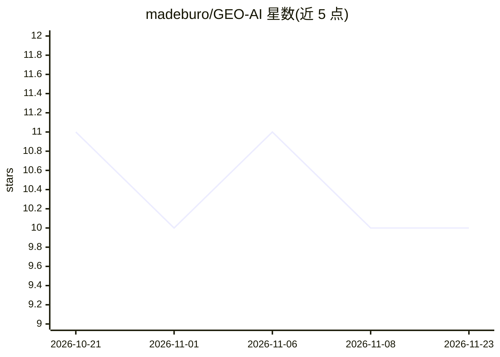

# madeburo/GEO-AI

⭐ 10 · TypeScript · MIT · 推送 2026-03-21 · [GitHub](https://github.com/madeburo/GEO-AI) · [官网](https://www.geoai.run) · 组织维护

**为网站生成 AI 搜索优化内容（llms.txt 等）的 TS 引擎**

零依赖的 TypeScript 引擎，面向 AI 搜索引擎优化网站内容：从任意数据源经 ContentProvider 接口生成 llms.txt/llms-full.txt，内置 16+ AI 爬虫注册表并支持按爬虫设置允许/禁止规则及 robots.txt 块生成，提供 TTL 缓存、GDPR 合规爬取日志（SHA-256 匿名化）、SEO 信号（meta 标签、Link 头、JSON-LD）与 AES-256-GCM 密钥加密。可选模块经 Claude 或 OpenAI API 批量生成 AI 描述。以多个 npm 包分发，覆盖 Next.js、NestJS、WordPress、Shopify 及 CLI。要求 Node.js 20+。

## 筛选速览

| 维度 | 判定 | 备注 |
|---|---|---|
| AI 角色 | `ai-ecosystem` | LLM/agent 周边工具 |
| 许可风险 | `permissive` | MIT |
| 部署形态 | `library` | 以包/库形式分发 |
| 模型依赖 | locked-api |  |
| 硬件要求 | — | 无带数字的原话,不猜 |
| 安装摩擦 | `low` | 无编译、无系统依赖或容器化 |
| 成熟度 | — | 结构信号不足 |

## 能力要点

- 从任意数据源生成 llms.txt 与 llms-full.txt
- 16+ AI 爬虫的按 bot 允许/禁止规则与 robots.txt 块生成
- 可选 AI 描述生成：经 Claude/OpenAI API，批量 50 条、并发 5、限流 10 req/min
- GDPR 合规爬取跟踪（SHA-256 IP 匿名化）与 TTL 缓存适配器

## 适用场景

- 为 Next.js/NestJS 网站生成并托管 llms.txt
- 按允许/禁止策略管理 GPTBot、ClaudeBot 等 AI 爬虫访问
- 为电商商品数据生成机器可读的价格/库存/变体信号
- 用 CLI 对既有项目校验 llms.txt

## 场景标签

 · 领域:Web 开发/搜索引擎优化

## 证据(README 行号)

> L13: A zero-dependency TypeScript engine that optimizes websites for AI search engines like ChatGPT, Claude, Gemini, Per
> L33: GEO AI provides infrastructure for **AI Search Optimization**:
> L35: - ✅ `llms.txt` generation — structured content for AI crawlers

## 星数曲线

2026-10-21 11 → 2026-11-23 10（-1）

---
*卡片 v1 · prompt 1.4 · 生成 2026-11-19 · 置信度 high · 依据 README sha `ea609c6d1f70` · [字段定义](../../DATASET.md)*
