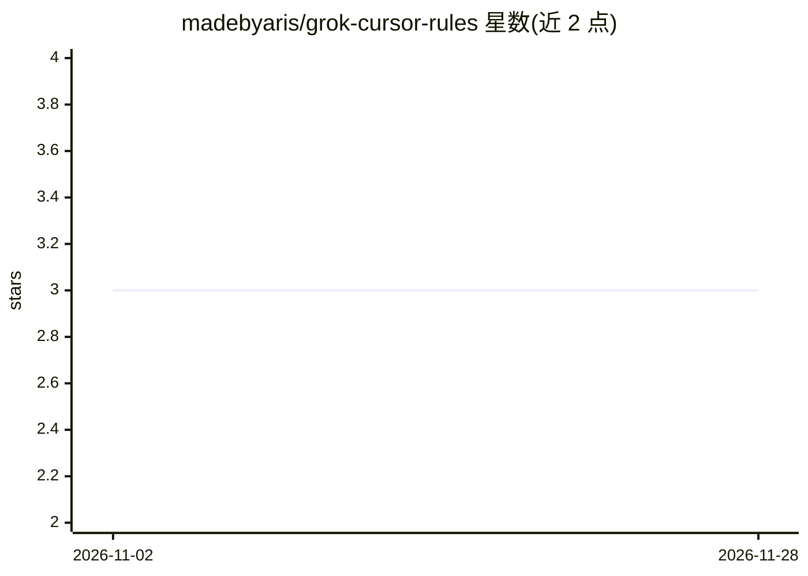

# madebyaris/grok-cursor-rules

⭐ 3 · MIT · 推送 2026-10-24 · [GitHub](https://github.com/madebyaris/grok-cursor-rules) · 个人维护

**为 Cursor 中的 Grok 4.7 提供行为规则的规则集**

一组面向 Cursor IDE 的规则文件：为 Grok 4.7 配置五个常驻规则与四个按需加载规则，覆盖工作循环、任务分流、评分、人工停顿点、开放简报加想法、截图视觉审查、写作风格、计划模式与图像生成。安装方式为 git clone 后复制 .cursor 文件夹到项目，或在 Cursor 设置中粘贴 User Rules。README 标明规则尚未在真实任务上测试，Grok 4.8 版本与 Cursor 之外版本尚在计划中。

## 筛选速览

| 维度 | 判定 | 备注 |
|---|---|---|
| AI 角色 | `ai-ecosystem` | LLM/agent 周边工具 |
| 许可风险 | `permissive` | MIT |
| 部署形态 | `None` |  |
| 模型依赖 | locked-api |  |
| 硬件要求 | — | 无带数字的原话,不猜 |
| 安装摩擦 | `low` | 无编译、无系统依赖或容器化 |
| 成熟度 | `idea` | |

## 能力要点

- 9 条规则：5 条常驻、4 条按需加载以控制上下文占用
- 截图审查机制：在宽屏与手机宽度下检查渲染结果，最多三轮修复
- 按需规则互链，未加载时 Grok 仍可读取
- 提供按项目复制 .cursor 文件夹与粘贴 User Rules 两种使用方式

## 适用场景

- 在 Cursor 中用 Grok 4.7 做带设计方向比较的前端开发
- 让模型对渲染结果做截图自查后修复
- 在开放简报下让模型额外给出一个带标签的想法

## 场景标签

`提示工程` · 领域:Agent 开发

## 证据(README 行号)

> L12: Cursor rules for Grok 4.7. They keep Grok's strong coding habits and add the parts it skips by default: compare des
> L14: These rules are written for Grok in Cursor. A tuned version for Grok 4.8 and a version for Grok outside Cursor, suc

## 星数曲线

2026-11-02 3 → 2026-11-28 3（+0）

---
*卡片 v1 · prompt 1.4 · 生成 2026-11-21 · 置信度 high · 依据 README sha `6e796e40bfd0` · [字段定义](../../DATASET.md)*
