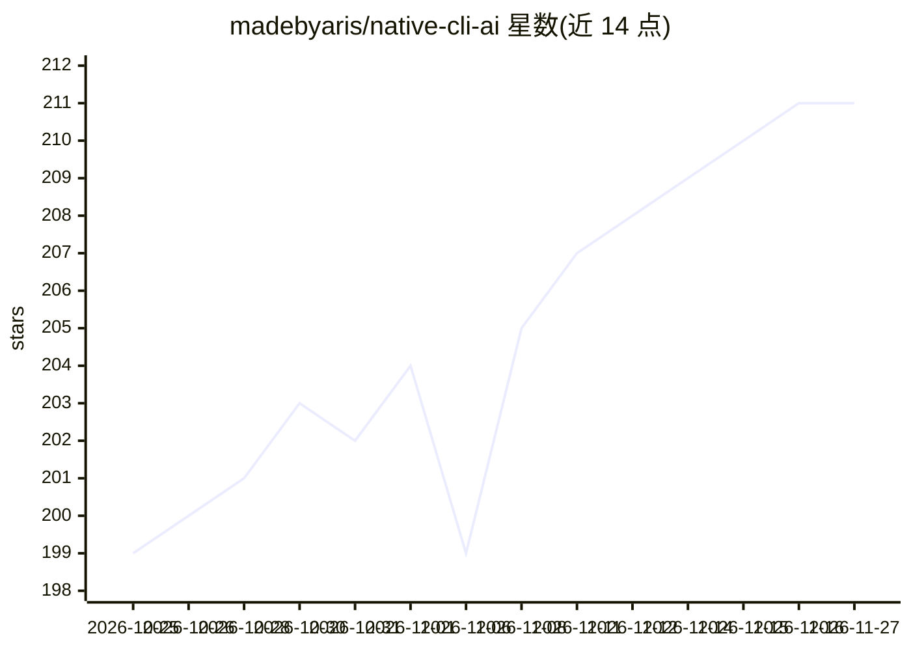

# madebyaris/native-cli-ai

⭐ 211 · Rust · MIT · 推送 2026-11-08 · [GitHub](https://github.com/madebyaris/native-cli-ai) · [官网](https://nca-cli.com) · 组织维护

**给终端开发者的单二进制 Rust 编码 Agent CLI**

Rust 原生编码 CLI，单二进制发行，面向本地优先、终端优先的工作流：交互式 TUI、行式 REPL、一次性运行、后台会话、attach/status/logs、JSON/NDJSON 输出、Unix-socket IPC、基于 git worktree 隔离的子 Agent 与自动研究任务。默认使用 MiniMax，可配置 OpenAI、Anthropic、OpenRouter、阿里 DashScope 及自定义端点；支持 MCP 工具、多模态消息、会话压缩与按模型计价的成本统计。危险操作（删除、sudo、push 等）前需确认。

## 筛选速览

| 维度 | 判定 | 备注 |
|---|---|---|
| AI 角色 | `ai-native` | 本体是模型或模型工具 |
| 许可风险 | `permissive` | MIT |
| 部署形态 | `desktop` | 安装包/桌面程序 |
| 模型依赖 | — | README 未给出锁定关系 |
| 硬件要求 | — | 无带数字的原话,不猜 |
| 安装摩擦 | `medium` | 含编译或系统依赖之一 |
| 成熟度 | — | 结构信号不足 |

## 能力要点

- 单二进制 Rust CLI：TUI/REPL/一次性/后台会话四种运行方式
- 子 Agent 带父子谱系与可选 git worktree 隔离
- JSON/NDJSON 输出与 Unix-socket IPC，可作自动化 worker
- 内置工具 + MCP（stdio/HTTP）扩展，多模态图片输入

## 适用场景

- 在终端里完成日常编码任务并保留可恢复的会话
- 后台派发分析任务，稍后用 status/logs/attach 查看
- 多 Agent 并行探索，子任务用独立 worktree 隔离
- 通过 JSON/NDJSON/IPC 把 Agent 接入自动化流水线

## 场景标签

`编码 Agent` · 领域:编码与开发

## 证据(README 行号)

> L16: `nca` is a Rust-native coding CLI that ships as a single binary. It is built for local-first, terminal-first workfl
> L78: - Uses MiniMax by default, with OpenAI, Anthropic, OpenRouter, Alibaba DashScope, and custom endpoint support.

## 星数曲线

2026-10-25 199 → 2026-11-27 211（+12）

---
*卡片 v1 · prompt 1.4 · 生成 2026-11-25 · 置信度 high · 依据 README sha `31d3c0af47ae` · [字段定义](../../DATASET.md)*
