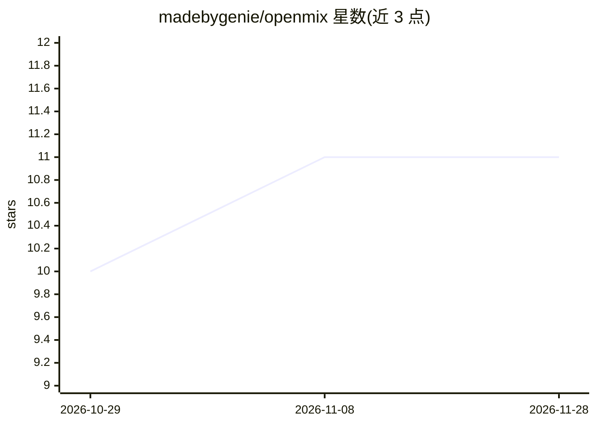

# madebygenie/openmix

⭐ 11 · Python · Apache-2.0 · 推送 2026-11-02 · [GitHub](https://github.com/madebygenie/openmix) · 组织维护

**给配方科学家的计算配方框架：成分解析与混合物验证**

面向化妆品、制药、食品、补充剂配方场景的 Python 框架：将 INCI 成分名解析为分子身份与理化性质（SMILES、LogP、MW、电荷、HLB），基于电荷平衡求解混合物 pH 并检验声明 pH 可达性，转换剂量基准（元素/活性形式换算），检测危险成分交互并输出验证报告。提供多种计算视角的 discourse 评估与工程/发现两种模式，附 CLI 与知识库（2,400+ 成分种子缓存，运行时回退 PubChem API）。

## 筛选速览

| 维度 | 判定 | 备注 |
|---|---|---|
| AI 角色 | `ai-native` | 本体是模型或模型工具 |
| 许可风险 | `permissive` | Apache-2.0 |
| 部署形态 | `library` | 以包/库形式分发 |
| 模型依赖 | — | README 未给出锁定关系 |
| 硬件要求 | — | 无带数字的原话,不猜 |
| 安装摩擦 | `low` | 无编译、无系统依赖或容器化 |
| 成熟度 | — | 结构信号不足 |

## 能力要点

- INCI→SMILES→理化性质的三级成分解析（种子缓存/用户缓存/PubChem 回退）
- 基于电荷平衡（Davies 活度）的混合物 pH 求解与声明 pH 可达性判定
- 危险交互验证与评分报告（如次氯酸钠+氨生成氯胺气体）
- 工程/发现两种模式共用同一物理观测引擎，附 CLI 与 Colab 入口

## 适用场景

- 在发布配方前检验声明 pH 是否可由成分组成实现
- 化妆品/膳食补充剂标签上的剂量形式与元素量换算
- 筛查配方中危险的成分组合与相容性问题
- 以多种计算视角评估同一配方并定位真实分歧点

## 场景标签

 · 领域:化学/配方科学

## 证据(README 行号)

> L3: ### The Open-Source Framework for Computational Formulation Science
> L30: OpenMix resolves any ingredient to its molecular identity and observes formulations through physics, out of the box
> L40: The physics observation engine resolves each ingredient to its molecular identity (INCI → SMILES → LogP, MW, charge

## 星数曲线

2026-10-29 10 → 2026-11-28 11（+1）

---
*卡片 v1 · prompt 1.4 · 生成 2026-11-18 · 置信度 high · 依据 README sha `216f06ae287a` · [字段定义](../../DATASET.md)*
