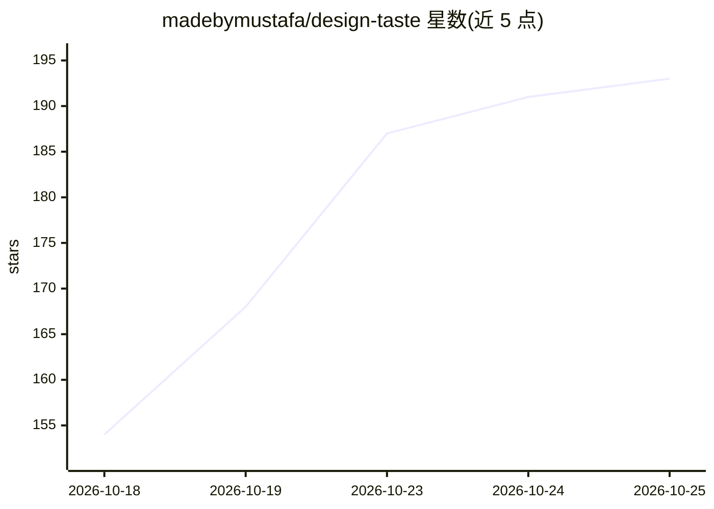

# madebymustafa/design-taste

⭐ 193 · JavaScript · MIT · 推送 2026-08-15 · [GitHub](https://github.com/madebymustafa/design-taste) · 个人维护

**给 AI 编码代理的 24 个设计品味技能包，避免模板化 UI**

面向 Claude Code、Cursor、Codex、opencode 等 AI 编码代理的技能集合：包含 1 个核心反模板技能（读取需求→声明设计方向→禁用 LLM 默认样式→细节打磨→检查清单）、10 个风格化 genre pack（如 editorial-minimal、japanese-minimal、cinematic-motion）、10 个 craft 技能（设计系统 token、排版、色彩、动效、可访问性、落地页、UX 文案、品牌）与 3 个代码技能（代码工艺、Web 性能、代码评审）。通过 git clone 与 install.sh 安装到各代理的 skills 目录，附 before/after 同题演示对比。MIT 许可。

## 筛选速览

| 维度 | 判定 | 备注 |
|---|---|---|
| AI 角色 | `ai-ecosystem` | LLM/agent 周边工具 |
| 许可风险 | `permissive` | MIT |
| 部署形态 | `None` |  |
| 模型依赖 | — | README 未给出锁定关系 |
| 硬件要求 | — | 无带数字的原话,不猜 |
| 安装摩擦 | `low` | 无编译、无系统依赖或容器化 |
| 成熟度 | — | 结构信号不足 |

## 能力要点

- 24 个技能：核心反模板技能 + 10 个 genre pack + craft/code 技能
- install.sh 自动安装到检测到的所有代理，validate.sh 校验安装
- 每个 genre pack 附同题 before/after HTML 演示
- 技能按 identity/details/delivery 三层组合使用

## 适用场景

- 让我的 AI 编码代理生成 UI 时摆脱千篇一律的默认样式
- 为项目选定一种设计风格身份并保持细节一致
- 给代理补充设计系统、排版、可访问性等参考级规则

## 场景标签

`提示工程` · 领域:Agent 开发

## 证据(README 行号)

> L9: This repo puts it back: **24 skills** (and counting) that teach your agent to read the brief, pick a design directio
> L78: ./scripts/install.sh              # installs all 24 skills to every agent it finds

## 星数曲线

2026-10-18 154 → 2026-10-25 193（+39）

---
*卡片 v1 · prompt 1.4 · 生成 2026-10-23 · 置信度 high · 依据 README sha `7585fd7c4b04` · [字段定义](../../DATASET.md)*
