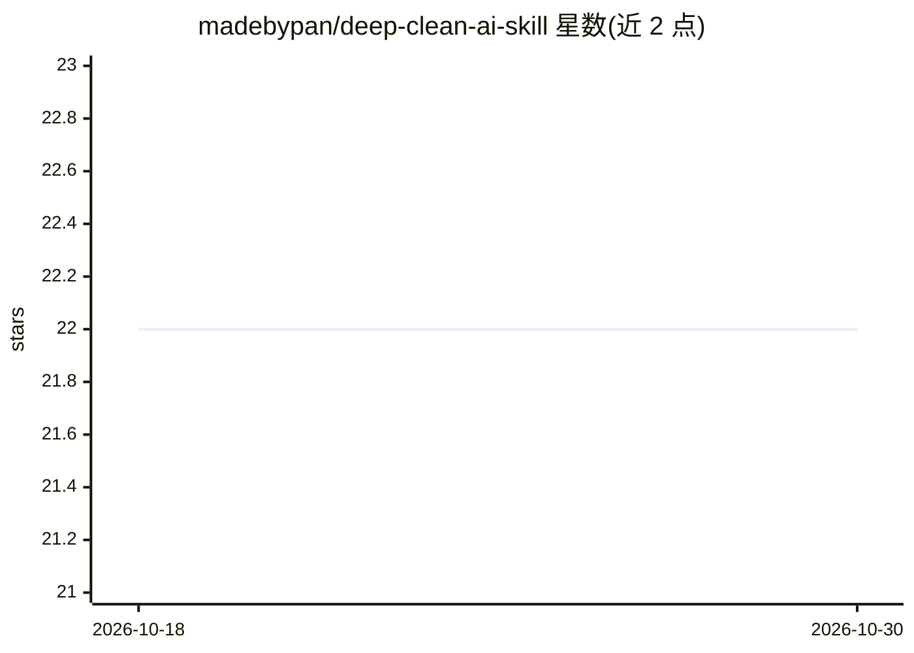

# madebypan/deep-clean-ai-skill

⭐ 22 · JavaScript · MIT · 推送 2026-08-09 · [GitHub](https://github.com/madebypan/deep-clean-ai-skill) · 个人维护 · 中文 README

**macOS 存储审计 Codex 技能：只读扫描并生成交互报告**

面向 Codex 的 macOS 存储审计技能：只读扫描缓存、可重建的开发产物、旧下载与异常大文件，按可重建性/影响/置信度等四个维度分类，生成本地自包含交互式 HTML 环形图报告供人工审阅；可选启动仅允许在 Finder 中定位项目的 localhost 桥接。明确排除删除、移动、重命名等任何文件修改操作。需要 macOS、Node.js 18+ 与具备文件系统/Shell 权限的 Codex；报告界面为繁体中文。

## 筛选速览

| 维度 | 判定 | 备注 |
|---|---|---|
| AI 角色 | `ai-ecosystem` | LLM/agent 周边工具 |
| 许可风险 | `permissive` | MIT |
| 部署形态 | `None` |  |
| 模型依赖 | — | README 未给出锁定关系 |
| 硬件要求 | — | 无带数字的原话,不猜 |
| 安装摩擦 | `low` | 无编译、无系统依赖或容器化 |
| 成熟度 | — | 结构信号不足 |

## 能力要点

- 只读扫描，不提供任何删除/清理工作流
- 每条候选记录可重建性、影响、分类置信度、命中规则与阈值
- 生成分组下钻的交互式环形图报告与可选 Finder Reveal 桥接
- Priority 1-5 排序，保守小计仅含易重建/低影响/高置信度项

## 适用场景

- 排查 Mac 磁盘空间占用，找出缓存与可重建的开发产物
- 在不改动文件的前提下生成候选清单供人工决定清理
- 从报告中定位具体文件到 Finder 进行检查

## 场景标签

 · 领域:系统工具/存储管理

## 证据(README 行号)

> L3: A strictly read-only macOS storage audit skill for Codex. It finds space-heavy caches, rebuildable developer artifac
> L31: - Codex with local filesystem and shell access
> L41: git clone https://github.com/madebypan/deep-clean-ai-skill.git ~/.codex/skills/deep-clean-ai-skill

## 星数曲线

2026-10-18 22 → 2026-10-30 22（+0）

---
*卡片 v1 · prompt 1.4 · 生成 2026-10-27 · 置信度 high · 依据 README sha `8604639ced9b` · [字段定义](../../DATASET.md)*
